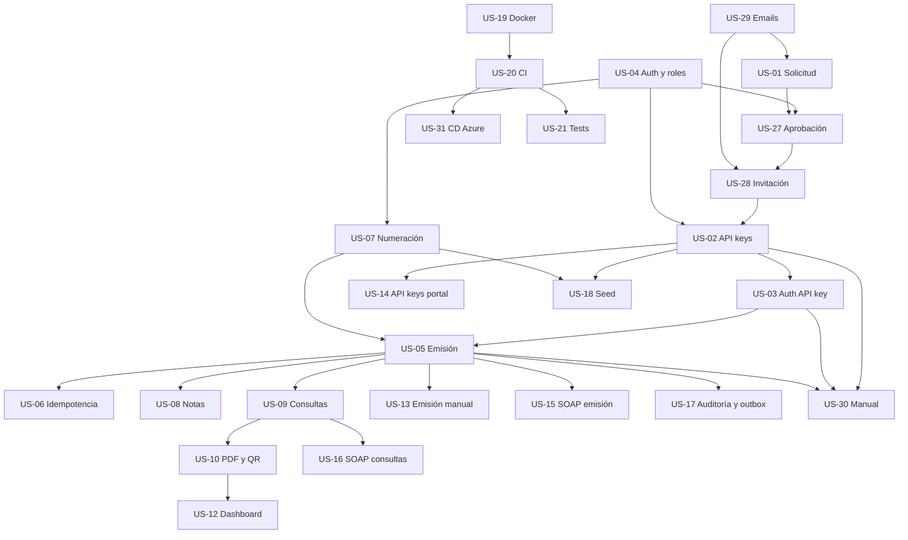

# Historias de usuario

El alcance obligatorio tiene 26 historias y 47 días ideales de trabajo. US-19, US-20 y US-31 están completadas y archivadas; quedan 23 historias activas. Las US-22 a US-26 son mejoras opcionales (stretch) y no forman parte del MVP. US-31 agrega la entrega continua y el despliegue en Azure.

Las US-27 a US-30 completan el onboarding profesional: solicitud pública, aprobación por administrador global, invitación por email y manual de integración. Los números no indican orden de implementación; el orden se define por dependencias.

> El proceso completo está documentado en [`docs/proceso-alta-empresa.md`](../proceso-alta-empresa.md). El manual para integradores está en [`docs/manual-integracion.md`](../manual-integracion.md).

## Documentos de referencia

| Documento | Para qué sirve |
| --- | --- |
| [`docs/contratos-api.md`](../contratos-api.md) | **Contrato transversal normativo**: catálogo de errores, roles, autenticación, idempotencia, paginación, emisión y endpoints. Si una historia y este documento se contradicen, manda el contrato. |
| [`docs/plan-implementacion.md`](../plan-implementacion.md) | **Plan maestro**: orden de ejecución por fases, paralelismo, prerrequisitos de infraestructura y checklists de demo y de entrega. |
| [`docs/modelos.md`](../modelos.md) | Forma de los datos en MongoDB: entidades, campos, colecciones e índices. |
| [`docs/requisitos-funcionales.md`](../requisitos-funcionales.md) | Qué debe hacer el sistema, con la trazabilidad RF ↔ US. |

## Índice

La columna **Contrato** indica si la historia ya tiene definido el contrato técnico completo (modelo de datos, endpoints, validaciones, casos de prueba y dependencias). Todas las historias del MVP lo tienen.

| ID | Historia | Épica | Prioridad | Días | Requisito | Estado | Contrato |
| --- | --- | --- | --- | --- | --- | --- | --- |
| [US-01](US-01-alta-contribuyente.md) | Solicitud pública de alta de empresa | Registro | Alta | 2 | RF-23 | Pendiente | Sí |
| [US-02](US-02-api-keys.md) | Gestión de API keys | Integraciones | Alta | 2 | RF-02 | Pendiente | Sí |
| [US-03](US-03-autenticacion-api-key.md) | Autenticación por API key | Integraciones | Alta | 1 | RF-03 | Pendiente | Sí |
| [US-04](US-04-login-multiempresa.md) | Autenticación, roles y aislamiento multiempresa | Registro | Alta | 3 | RF-11 | Pendiente | Sí |
| [US-05](US-05-emision-facturas.md) | Emisión de facturas A, B y C | Emisión | Alta | 3 | RF-04 | Pendiente | Sí |
| [US-06](US-06-idempotencia.md) | Idempotencia de emisión | Emisión | Alta | 1 | RF-05 | Pendiente | Sí |
| [US-07](US-07-numeracion-atomica.md) | Numeración atómica | Emisión | Alta | 1 | RF-06 | Pendiente | Sí |
| [US-08](US-08-notas-credito-debito.md) | Notas de crédito y débito | Emisión | Alta | 2 | RF-07 | Pendiente | Sí |
| [US-09](US-09-consultas-comprobantes.md) | Consultas y último autorizado | Consultas | Alta | 1 | RF-08 | Pendiente | Sí |
| [US-10](US-10-pdf-qr.md) | PDF con código QR | Documentos | Alta | 2 | RF-09 | Pendiente | Sí |
| [US-11](US-11-verificacion-publica.md) | Verificación pública por CAE | Consultas | Alta | 2 | RF-10 | Base implementada | Sí |
| [US-12](US-12-dashboard-listado.md) | Dashboard y listado | Portal | Media | 2 | RF-13 | Pendiente | Sí |
| [US-13](US-13-emision-manual.md) | Emisión manual desde el portal | Portal | Media | 2 | RF-12 | Pendiente | Sí |
| [US-14](US-14-api-keys-portal.md) | API keys desde el portal | Portal | Media | 1 | RF-14 | Pendiente | Sí |
| [US-15](US-15-soap-emision.md) | SOAP de emisión | Interoperabilidad | Alta | 2 | RF-15 | Pendiente | Sí |
| [US-16](US-16-soap-consultas.md) | SOAP de consultas | Interoperabilidad | Media | 1 | RF-16 | Pendiente | Sí |
| [US-17](US-17-auditoria-outbox.md) | Auditoría y outbox | Operación | Media | 2 | RF-17 | Pendiente | Sí |
| [US-18](US-18-parametros-seed.md) | Parámetros y datos semilla | Operación | Media | 1 | RF-18 | Pendiente | Sí |
| [US-19](../historias-usuario-terminadas/US-19-docker-compose.md) | Docker y Docker Compose | Infraestructura | Alta | 2 | RF-21 | Completada | — |
| [US-20](../historias-usuario-terminadas/US-20-integracion-continua.md) | Integración continua (CI) | Infraestructura | Alta | 1 | RF-21 | Completada | — |
| [US-21](US-21-tests-documentacion.md) | Tests, Postman y documentación | Calidad | Alta | 2 | RNF-13/17/18 | Parcial | Sí |
| [US-22](US-22-mvc-anulacion.md) | Anulación administrativa MVC | Administración | Baja | 2 | RF-19 | Stretch | No |
| [US-23](US-23-webhooks.md) | Webhooks de eventos | Integraciones | Baja | 2 | RF-20 | Stretch | No |
| [US-24](US-24-afip-real.md) | Adaptador AFIP real | Interoperabilidad | Baja | 3 | RF-22 | Stretch | No |
| [US-25](US-25-grpc-graphql.md) | gRPC o GraphQL | Interoperabilidad | Baja | 3 | RNF-15 | Stretch | No |
| [US-26](US-26-kubernetes.md) | Despliegue en Kubernetes | Infraestructura | Baja | 3 | RNF-10 | Stretch | No |
| [US-27](US-27-aprobacion-solicitudes.md) | Revisión y aprobación de solicitudes | Registro | Alta | 3 | RF-24 | Pendiente | Sí |
| [US-28](US-28-invitacion-cuenta.md) | Activación de cuenta por invitación | Registro | Alta | 2 | RF-25 | Pendiente | Sí |
| [US-29](US-29-emails-transaccionales.md) | Notificaciones transaccionales por email | Registro | Alta | 2 | RF-26 | Pendiente | Sí |
| [US-30](US-30-manual-integracion.md) | Manual online de integración | Portal | Media | 1 | RF-27 | Pendiente | Sí |
| [US-31](../historias-usuario-terminadas/US-31-entrega-continua-azure.md) | Entrega continua y despliegue en Azure | Infraestructura | Alta | 3 | RNF-20 / RF-21 | Completada | — |

### Estado real de la implementación

Al día de hoy **solo US-11 tiene comportamiento implementado**: la API expone `GET /`, `GET /health`, `GET /health/live` y `GET /v1/comprobantes/verificar/{cae}`, y el portal expone la página `/verificar`.

El resto de las historias tiene el **modelo de dominio y los índices de MongoDB preparados**, pero sin casos de uso, endpoints ni pantallas. Eso no cuenta como avance: una historia está terminada cuando entrega comportamiento verificable con test.

## Dependencias

| Historia | Depende de | Habilita |
| --- | --- | --- |
| US-01 | US-29 | US-27 |
| US-02 | US-04, US-28 | US-03, US-14, US-18 |
| US-03 | US-02 | US-05, US-09, US-15, US-16 |
| US-04 | — | US-02, US-05, US-07, US-12, US-13, US-14, US-27, US-28 |
| US-05 | US-03, US-07 | US-06, US-08, US-09, US-11, US-13, US-17, US-18, US-21, US-24 |
| US-06 | US-05 | US-21 |
| US-07 | US-04 | US-05, US-08, US-18 |
| US-08 | US-05 | US-09, US-10, US-12, US-13 |
| US-09 | US-03, US-05 | US-10, US-12, US-16, US-21 |
| US-10 | US-05, US-09 | US-12, US-13, US-21 |
| US-11 | US-05, US-18 (flujo completo) | US-10, US-30 |
| US-12 | US-04, US-09, US-10 | US-21 |
| US-13 | US-04, US-05, US-10 | US-21 |
| US-14 | US-02, US-04, US-28 | US-21, US-30 |
| US-15 | US-03, US-05 | US-16, US-21, US-24 |
| US-16 | US-03, US-09 | US-21 |
| US-17 | US-05, US-27, US-28 | US-23, US-30 |
| US-18 | US-02, US-04, US-07 | US-11, US-21 |
| US-19 | — | US-20, US-26 |
| US-20 | US-19 | US-21, US-26, US-31 |
| US-21 | Todas las implementadas; CI depende de US-20 y CD de US-31 | — |
| US-22 | US-04, US-05, US-08 | — |
| US-23 | US-02, US-05, US-17 | — |
| US-24 | US-05, US-15 | — |
| US-25 | US-05, US-09 | — |
| US-26 | US-19, US-20, US-31 | — |
| US-27 | US-01, US-04, US-29 | US-28 |
| US-28 | US-04, US-27, US-29 | US-02, US-14 |
| US-29 | US-19 | US-01, US-27, US-28 |
| US-30 | US-02, US-03, US-05 | US-21 |
| US-31 | US-19, US-20 | US-21, US-26 |

## Orden recomendado

1. **Base de acceso:** US-04, US-29.
2. **Onboarding:** US-01, US-27, US-28.
3. **Integraciones:** US-02, US-03.
4. **Emisión:** US-07, US-05, US-06, US-08, US-09.
5. **Documentos y portal:** US-10, US-11, US-12, US-13, US-14, US-30.
6. **Interoperabilidad y operación:** US-15, US-16, US-17, US-18.
7. **Calidad y despliegue:** US-20, US-31, US-21.
8. **Stretch:** US-22 a US-26.

El plan detallado por fases, con paralelismo, prerrequisitos de infraestructura y checklists, está en [`docs/plan-implementacion.md`](../plan-implementacion.md).

## Grafo simplificado

US-26 (Kubernetes) queda fuera del grafo: es stretch y hay una decisión de plataforma fechada que la descarta para el MVP. Ver [`docs/historias-usuario/US-26-kubernetes.md`](US-26-kubernetes.md).

## Reglas de lectura

1. Leer este índice y solo la historia solicitada.
2. Verificar las dependencias antes de implementar.
3. Si falta una dependencia, detenerse y reportar el bloqueo; no inventar un atajo.
4. Implementar solo el alcance de la historia.
5. Respetar [`docs/contratos-api.md`](../contratos-api.md): si la historia y el contrato se contradicen, manda el contrato.
6. Marcar un checkbox solo con evidencia verificable.
7. Al completar todos los criterios y el Definition of Done, mover el archivo a `historias-usuario-terminadas/` y actualizar este índice.
8. No implementar historias stretch sin pedido explícito.

## Leyenda de estado

- **Pendiente:** no implementada.
- **Base implementada:** existe el esqueleto funcional, falta completar la historia.
- **Parcial:** parte de la historia está cubierta.
- **Completada:** todos los criterios y el Definition of Done están verificados.
- **Stretch:** fuera del alcance obligatorio.

La columna **Contrato** es independiente del estado: `Sí` significa que la historia tiene su contrato técnico definido y listo para implementar, no que la funcionalidad exista.
