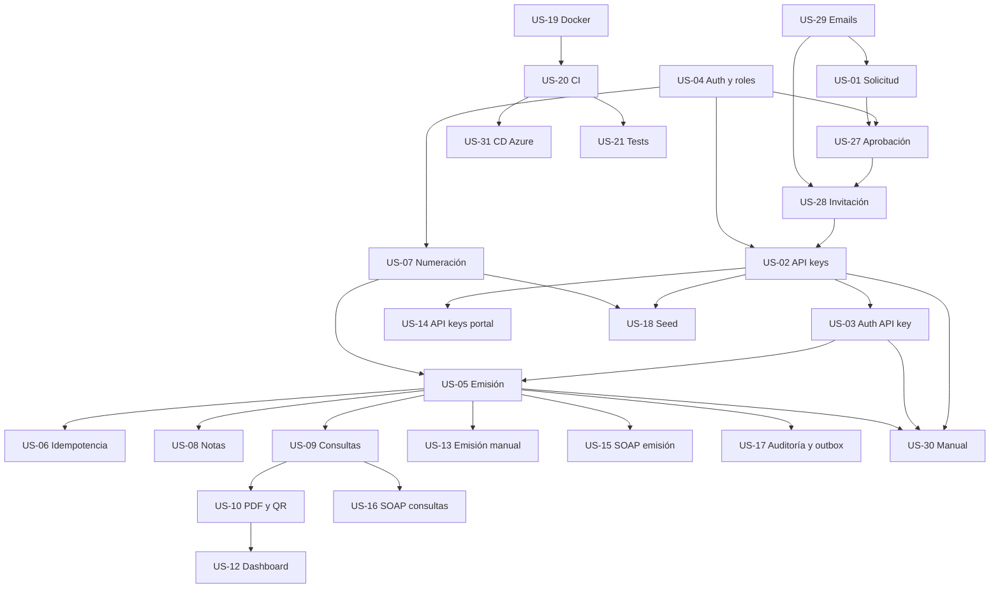

# Historias de usuario

El alcance obligatorio tiene **26 historias y 47 días ideales de trabajo**, y **se implementan en un único sprint**. US-12, US-13, US-19, US-20, US-27, US-28 y US-31 están completadas y archivadas; quedan 19 historias activas.

Las US-22 a US-25 **quedan fuera del alcance del proyecto** y están archivadas en [`docs/historias-usuario-fuera-de-alcance/`](../historias-usuario-fuera-de-alcance/README.md). No se implementan ni se cuentan para el avance del MVP.

El sprint se ejecuta en **6 fases** que son, al mismo tiempo, el orden de implementación: las historias de una fase dependen de las anteriores. Dentro de una fase, las historias sin dependencia mutua se pueden tomar en paralelo.

Las US-27 a US-30 completan el onboarding profesional: solicitud pública, aprobación por administrador global, invitación por email y manual de integración. Los números no indican orden de implementación; el orden lo define la columna **Orden**.

> El proceso completo está documentado en [`docs/proceso-alta-empresa.md`](../proceso-alta-empresa.md). El manual para integradores está en [`docs/manual-integracion.md`](../manual-integracion.md).

## Documentos de referencia

| Documento | Para qué sirve |
| --- | --- |
| [`docs/contratos-api.md`](../contratos-api.md) | **Contrato transversal normativo**: catálogo de errores, roles, autenticación, idempotencia, paginación, emisión y endpoints. Si una historia y este documento se contradicen, manda el contrato. |
| [`docs/plan-implementacion.md`](../plan-implementacion.md) | **Plan maestro**: fases del sprint, paralelismo, prerrequisitos de infraestructura, condición de salida y checklists de demo y de entrega. |
| [`docs/modelos.md`](../modelos.md) | Forma de los datos en MongoDB: entidades, campos, colecciones e índices. |
| [`docs/requisitos-funcionales.md`](../requisitos-funcionales.md) | Qué debe hacer el sistema, con la trazabilidad RF ↔ US. |
| [`docs/historias-usuario-fuera-de-alcance/README.md`](../historias-usuario-fuera-de-alcance/README.md) | Historias archivadas que **no entran** en el alcance del proyecto (US-22 a US-25). |

## Índice

La columna **Orden** es la posición dentro del sprint. La columna **Contrato** indica si la historia ya tiene definido el contrato técnico completo (modelo de datos, endpoints, validaciones, casos de prueba y dependencias). Todas las historias del MVP lo tienen.

| Orden | ID | Historia | Épica | Fase | Prioridad | Días | Requisito | Estado | Contrato |
| --- | --- | --- | --- | --- | --- | --- | --- | --- | --- |
| 1 | [US-04](US-04-login-multiempresa.md) | Autenticación, roles y aislamiento multiempresa | Registro | 1 | Alta | 3 | RF-11 | Base implementada | Sí |
| 2 | [US-29](US-29-emails-transaccionales.md) | Notificaciones transaccionales por email | Registro | 1 | Alta | 2 | RF-26 | Parcial | Sí |
| 3 | [US-01](US-01-alta-contribuyente.md) | Solicitud pública de alta de empresa | Registro | 2 | Alta | 2 | RF-23 | Parcial | Sí |
| 4 | [US-27](../historias-usuario-terminadas/US-27-aprobacion-solicitudes.md) | Revisión y aprobación de solicitudes | Registro | 2 | Alta | 3 | RF-24 | Completada | Sí |
| 5 | [US-28](../historias-usuario-terminadas/US-28-invitacion-cuenta.md) | Activación de cuenta por invitación | Registro | 2 | Alta | 2 | RF-25 | Completada | Sí |
| 6 | [US-02](US-02-api-keys.md) | Gestión de API keys | Integraciones | 3 | Alta | 2 | RF-02 | Parcial | Sí |
| 7 | [US-03](US-03-autenticacion-api-key.md) | Autenticación por API key | Integraciones | 3 | Alta | 1 | RF-03 | Base implementada | Sí |
| 8 | [US-07](US-07-numeracion-atomica.md) | Numeración atómica | Emisión | 3 | Alta | 1 | RF-06 | Base implementada | Sí |
| 9 | [US-18](US-18-parametros-seed.md) | Parámetros y datos semilla | Operación | 3 | Media | 1 | RF-18 | Parcial | Sí |
| 10 | [US-05](US-05-emision-facturas.md) | Emisión de facturas A, B y C | Emisión | 4 | Alta | 3 | RF-04 | Parcial | Sí |
| 11 | [US-06](US-06-idempotencia.md) | Idempotencia de emisión | Emisión | 4 | Alta | 1 | RF-05 | Parcial | Sí |
| 12 | [US-08](../historias-usuario-terminadas/US-08-notas-credito-debito.md) | Notas de crédito y débito | Emisión | 4 | Alta | 2 | RF-07 | Completada | Sí |
| 13 | [US-09](US-09-consultas-comprobantes.md) | Consultas y último autorizado | Consultas | 5 | Alta | 1 | RF-08 | Parcial | Sí |
| 14 | [US-10](US-10-pdf-qr.md) | PDF con código QR | Documentos | 5 | Alta | 2 | RF-09 | Parcial | Sí |
| 15 | [US-12](../historias-usuario-terminadas/US-12-dashboard-listado.md) | Dashboard y listado | Portal | 5 | Media | 2 | RF-13 | Completada | Sí |
| 16 | [US-13](../historias-usuario-terminadas/US-13-emision-manual.md) | Emisión manual desde el portal | Portal | 5 | Media | 2 | RF-12 | Completada | Sí |
| 17 | [US-14](US-14-api-keys-portal.md) | API keys desde el portal | Portal | 5 | Media | 1 | RF-14 | Parcial | Sí |
| 18 | [US-15](US-15-soap-emision.md) | SOAP de emisión | Interoperabilidad | 6 | Alta | 2 | RF-15 | Parcial | Sí |
| 19 | [US-16](US-16-soap-consultas.md) | SOAP de consultas | Interoperabilidad | 6 | Media | 1 | RF-16 | Parcial | Sí |
| 20 | [US-17](US-17-auditoria-outbox.md) | Auditoría y outbox | Operación | 6 | Media | 2 | RF-17 | Parcial | Sí |
| 21 | [US-30](US-30-manual-integracion.md) | Manual online de integración | Portal | 6 | Media | 1 | RF-27 | Pendiente | Sí |
| 22 | [US-21](US-21-tests-documentacion.md) | Tests, Postman y documentación | Calidad | 6 | Alta | 2 | RNF-13/17/18 | Parcial | Sí |
| 23 | [US-11](US-11-verificacion-publica.md) | Verificación pública por CAE | Consultas | 6 | Alta | 2 | RF-10 | Base implementada | Sí |
| — | [US-19](../historias-usuario-terminadas/US-19-docker-compose.md) | Docker y Docker Compose | Infraestructura | — | Alta | 2 | RF-21 | Completada | — |
| — | [US-20](../historias-usuario-terminadas/US-20-integracion-continua.md) | Integración continua (CI) | Infraestructura | — | Alta | 1 | RF-21 | Completada | — |
| — | [US-31](../historias-usuario-terminadas/US-31-entrega-continua-azure.md) | Entrega continua y despliegue en Azure | Infraestructura | — | Alta | 3 | RNF-20 / RF-21 | Completada | — |

### Estado real de la implementación

Al día de hoy **US-11, US-04, US-03, US-05, US-13 y US-14 tienen comportamiento implementado**: la API expone `GET /`, `GET /health`, `GET /health/live`, `GET /v1/comprobantes/verificar/{cae}`, `POST /v1/comprobantes`, `GET /v1/comprobantes`, `GET /v1/comprobantes/{id}`, `GET /v1/comprobantes/{id}/pdf`, `GET /v1/comprobantes/ultimo-autorizado`, `GET /v1/comprobantes/dashboard`, `POST /v1/comprobantes/presupuesto`, `GET /v1/puntos-venta`, `POST /v1/auth/login`, `POST /v1/auth/logout`, `GET /v1/auth/me`, `POST /v1/admin/auth/login`, `POST /v1/admin/auth/logout`, `GET /v1/admin/auth/me` y los cuatro endpoints de `/v1/api-keys` (US-02); el portal expone `/` (dashboard), `/inicio` (landing pública), `/comprobantes`, `/comprobantes/{id}`, `/comprobantes/nuevo`, `/verificar`, `/login`, `/logout`, `/admin/login`, `/admin/logout`, `/admin` y `/api-keys`. US-04 queda en **Base implementada** porque el aislamiento multiempresa se completa con los endpoints de negocio de US-02, US-05 y US-09. US-03 ya se aplica a emisión y SOAP (`RequireApiKey`) y a consultas con la política combinada API key/cookie de US-09. US-12 está **Completada**: entrega el dashboard (`/`), el listado filtrable y paginado (`/comprobantes`) y el detalle con descarga de PDF (`/comprobantes/{id}`), con aislamiento por contribuyente y cobertura de tests con MongoDB real y QA manual completo. US-13 está **Completada**: el portal emite desde `/comprobantes/nuevo` con cálculo de presupuesto, idempotencia, resultado y PDF, con autorización `Administrador`/`Emisor`.

El cierre de QA del 2026-11-05 está documentado en [`docs/qa-cierre-2026-11-05.md`](../qa-cierre-2026-11-05.md): se marcaron los checks verificables con build, tests y código; los pendientes son verificaciones con MongoDB real, navegador, SMTP staging o lector QR, no funcionalidad faltante.

**US-29** queda en **Parcial**: el servicio de email está implementado y probado —`IEmailSender`, `EmailService`, las cinco plantillas, remitente de archivo en desarrollo, remitente SMTP y validación de configuración al arrancar—. US-01 ya dispara la confirmación de solicitud y US-27 dispara aprobación, rechazo y reenvío, con la advertencia y el reenvío en el panel de solicitudes. Faltan la verificación del flujo completo sobre Mongo real, el envío exitoso con SMTP staging y el QA de la advertencia de fallo en el panel.

**US-01** queda en **Parcial**: `POST /v1/solicitudes-alta` y la página `/solicitar-alta` están implementados y cubiertos por tests automáticos (unitarios y de integración); falta la verificación con Mongo real y el QA del camino feliz.

**US-18** queda en **Parcial**: `ParametrosFacturacion`, `ParametrosService` y la colección `parametros` con índice único están implementados; el seed (`SeedService`, `SeedRepository`, `SeedHostedService`) crea la empresa demo, los usuarios `Administrador`, `Emisor` y `Consulta`, el `SuperAdmin`, el punto de venta, las secuencias y los parámetros globales con idempotencia lógica, y la API key demo opcional solo en Development. Los tests unitarios y de integración sin Mongo pasan. Faltan la verificación real con Mongo de CP-18.06/07/08/11/13/14/15 y del índice único de `parametros`, el QA manual del seed y CP-18.04/18.05 de punta a punta, que dependen de `EmitirComprobanteService` (US-05).

**US-27** queda **Completada**: la consola global lista, filtra, edita, aprueba, rechaza y reenvía invitaciones (`/v1/admin/solicitudes` y `/admin/solicitudes` en el portal). La aprobación crea contribuyente, punto de venta e invitación en una transacción de MongoDB y dispara los emails de US-29 después del commit.

**US-28** queda **Completada**: el link del email abre `/activar`, valida el token (`GET /v1/invitaciones/{token}`) y crea el usuario administrador de la empresa en una transacción que marca la invitación como usada (`POST /v1/invitaciones/{token}/aceptar`). Con US-01, US-27 y US-28 el onboarding funciona de punta a punta.

**US-08** queda **Completada**: `POST /v1/comprobantes` emite notas de crédito y débito A, B y C sobre una factura de la misma letra (`comprobanteOriginalId`). Cada nota tiene número y CAE propios, y el saldo ajustable de la factura se actualiza en la misma transacción con control de concurrencia.

**US-02** queda **Parcial**: los cuatro endpoints de `/v1/api-keys` con la política `EmpresaAdministrador`, el generador/hasher y los servicios de creación, listado, revocación y regeneración están implementados y cubiertos por tests unitarios; falta la corrida real con Mongo (`MongoApiKeysTests` CP-01 a CP-15 se omiten sin connection string) y las verificaciones de punta a punta con la API real.

**US-14** queda en **Parcial**: la página `/api-keys` del portal lista, crea, revoca y regenera keys contra los endpoints de US-02, muestra el valor completo una sola vez en un modal con botón «Copiar» y aplica la autorización por rol: un usuario `Consulta` recibe «Acceso denegado» y la API responde `403 SIN_PERMISOS`. La verificación en Chrome headless contra un stub de la API aprobó CP-01 a CP-09, CP-11 a CP-13 y CP-15. Faltan las verificaciones contra la API y MongoDB reales: CP-10 y el aislamiento por empresa, que la key revocada o regenerada deje de autenticar en `GET /v1/comprobantes`, CP-14 (contexto no seguro), CP-05/CP-13 contra la API real, y la revisión responsive y de foco visible en móvil.

**US-03** queda en **Base implementada**: el esquema `ApiKey` (`ApiKeyAuthenticationHandler`), la política `ApiKeyNegocio` con `RequireApiKey()`, `IApiKeyAuthenticator` (formato `fak_<12hex>_<43 base64url>`, búsqueda por prefijo y comparación con `FixedTimeEquals`), los claims `contribuyenteId`/`apikeyId`/`plano`, el registro de `UltimoUso` tolerante a fallos y los tests unitarios y de integración están implementados. Falta aplicarlo a endpoints de negocio reales cuando existan US-05/US-09 y correr los casos con Mongo real (`MongoApiKeyAuthenticationTests` se omiten sin connection string). La verificación pública por CAE sigue anónima.

**US-07** queda en **Base implementada**: `ISecuenciaRepository`, `SecuenciaService` y `SecuenciaRepository` (`FindOneAndUpdate` con `$inc`, `ReturnDocument.After` e `IsUpsert`) están implementados, con guard de transacción activa, excepciones de punto de venta y tests unitarios verdes. Los 11 casos `[MongoFact]` de `MongoSecuenciasTests` se omiten sin connection string, así que la concurrencia y el rollback contra MongoDB con replica set siguen sin verificar. La integración en `EmitirComprobanteService`, el mapeo HTTP `404`/`409` y el último autorizado dependen de US-05 y US-09.

**US-05** queda en **Parcial**: `POST /v1/comprobantes` emite facturas A, B y C con API key y `Idempotency-Key`, valida emisor, punto de venta, receptor, ítems e importes, calcula neto/IVA/total por tipo, asigna el número con US-07, genera el CAE, persiste el comprobante con el evento `comprobante.emitido` dentro de la transacción y responde `201` con `ComprobanteResponse`. Está cubierto por tests unitarios y de integración sin Mongo (496 aprobados, 121 omitidos, 0 fallos) y documentado en OpenAPI, Postman y el manual. Faltan la verificación real con MongoDB en replica set de la transacción, el rollback, la concurrencia CP-05-18 y el índice único de CAE, además del QA manual del camino feliz. La emisión desde el portal es US-13 (implementada).

**US-15** queda en **Parcial**: `POST /soap` publica `FECAESolicitar` y `FECAEGenerar` con SOAP 1.1; el WSDL está en `GET /soap?wsdl`, la autenticación reutiliza la API key por header o `Auth/Token`, el `Cuit` del request se compara con el contribuyente autenticado y `FECAESolicitar` delega en `EmitirComprobanteService`. La fachada reutiliza la idempotencia de US-06 y mapea `IDEMPOTENCIA_CONFLICTO`. Está cubierto por 19 tests unitarios de contrato/mapeo/faults, 3 de `ValidarAsync` y 10 de integración (WSDL, autenticación, XML inválido, éxito, aislamiento, errores y `Soap:Habilitado=false`). El QA manual verificó WSDL `200`, `401 API_KEY_AUSENTE`, `400 VALIDACION`, `503 MONGO_NO_DISPONIBLE` con Mongo caído y `404` con el endpoint deshabilitado. Faltan la emisión end-to-end con MongoDB replica set (CP-15.02/03/06/08/10), la verificación real de replay/conflicto y la validación del WSDL en SoapUI/Postman. El contrato no transporta `RazonSocial` del receptor, así que por SOAP solo se emite Factura C de punta a punta.

**US-16** queda en **Parcial**: el mismo endpoint `POST /soap` y el WSDL `GET /soap?wsdl` exponen `FECompUltimoAutorizado`, `FECompConsultar` y `FEDummy` (`IContractConsultas` / `ContractFecae`), con autenticación por API key (`X-Api-Key` o `Auth/Token`), aislamiento por `ContribuyenteId`, reutilización de `ObtenerUltimoAutorizadoService` y `ConsultarComprobanteService` (US-09), y mapeo sin filtración de datos fiscales en errores (`ConsultasMapeador`). Cubierto por tests unitarios y de integración sin Mongo (542 unitarios y 145 de integración aprobados, 157 integración omitidos sin connection string, 0 fallos, incluidos CP-16.01 a CP-16.12); queda pendiente la verificación end-to-end con MongoDB real.

**US-09** queda en **Parcial**: `GET /v1/comprobantes`, `GET /v1/comprobantes/{id}` y `GET /v1/comprobantes/ultimo-autorizado` están implementados con filtro por `ContribuyenteId`, paginación (`page`/`pageSize`, máximo 100), orden `{FechaEmision:-1, Numero:-1, Id:1}`, detalle con ítems y último autorizado desde `secuencias`. Los tres aceptan API key o cookie de empresa con rol `Administrador`, `Emisor` o `Consulta`, y el índice `ix_comprobantes_contribuyente_fecha_numero_id` quedó en `MongoIndexInitializer`. Cubierto por 49 unitarios y 18 tests de integración sin Mongo; los 13 `[MongoFact]` de `MongoConsultasComprobantesTests` se omiten sin connection string, así que faltan la verificación real con MongoDB (aislamiento, filtros, orden, último autorizado e índice) y el QA manual con datos reales.

**US-10** queda en **Parcial**: `GET /v1/comprobantes/{id}/pdf` genera el PDF de un comprobante propio con QuestPDF y el QR de verificación con QRCoder (`{Portal:BaseUrl}/verificar?cae=<CAE>`), con `Content-Disposition: inline` y nombre `{PuntoVenta:D4}-{Numero:D8}.pdf`. El endpoint acepta API key o cookie de empresa, filtra por `ContribuyenteId` y responde `400`, `401`, `403`, `404`, `500` o `503` según el contrato. Está cubierto por 22 tests sin Mongo (6 de contenido, 7 de modelo y 9 de endpoint) y documentado en OpenAPI, el manual, `.http` y Postman. Los 5 `[MongoFact]` de `MongoComprobantePdfTests` se omiten sin connection string, así que faltan la verificación real con MongoDB (PDF persistido, aislamiento y regeneración sin cambios), la lectura del QR de un PDF real con un lector estándar y la generación en el contenedor Docker Linux.

**US-12** queda en **Completada**: `GET /v1/comprobantes/dashboard` devuelve las métricas del mes (`mes=YYYY-MM` opcional, periodo UTC), el último CAE, el máximo número autorizado y los últimos cinco comprobantes, con API key o cookie de empresa y `ContribuyenteId` resuelto desde la credencial. El portal expone `/` (dashboard), `/comprobantes` (filtros y paginación) y `/comprobantes/{id}` (detalle) reutilizando US-09 y US-10; la landing pública pasó a `/inicio`. Está cubierto por 14 tests unitarios, 11 de integración y 7 `MongoFact`; la suite completa con MongoDB real (Atlas, base temporal QA) pasó con 556 unitarios + 320 integración, 0 omitidos y 0 fallos. La QA manual con Playwright contra API, portal y Mongo reales verificó CP-01 a CP-14: dashboard con datos, estado vacío, aislamiento, filtros y paginación, PDF, detalle, formato argentino, conservación de filtros, error y reintento, carga SSR, teclado, responsive, conciliación dashboard/listado y rol `Consulta`.

**US-17** queda en **Parcial**: `EventoAuditoria` incluye `ActorTipo`, `AdministradorId` y `ContribuyenteId` nullable; `AuditoriaValidator` valida coherencia de actores y bloquea tokens, hashes, prefijos de API key, contraseñas y secretos; las acciones de login, logout, solicitud, aprobación, rechazo, invitación, activación, API keys y emisión quedan auditadas. La outbox tiene `IOutboxRepository` con claim atómico, `OutboxWorker` con reintentos y backoff exponencial, máximo configurable (`Outbox:MaxIntentos`), auditoría `OutboxProcesado`/`OutboxFallido` y consulta de soporte por `Id` o `Estado` + `CreatedAt`. Cubierto por 601 unitarios y 158 integraciones sin Mongo (174 omitidos). Faltan la verificación con MongoDB real del claim concurrente, las consultas y el encolado transaccional, el `explain()` de los índices y el QA manual de intervalos reales.

**US-06** queda en **Parcial**: `PayloadHasher` calcula el SHA-256 hexadecimal del payload canónico, `IdempotenciaService` resuelve Nuevo/Replay/Conflicto y `EmitirComprobanteService` responde `200` con el mismo `id`, `numero` y `cae` sin renumerar ni regenerar CAE, `409 IDEMPOTENCIA_CONFLICTO` ante payload distinto y una relectura acotada al perder la carrera. El middleware hace eco de `Idempotency-Key` en todas las respuestas, incluidas `401`/`403`. CP-06-01 a CP-06-12 están verificados con tests automáticos y con MongoDB replica set en CI (737 aprobados, 0 fallos), incluida la concurrencia CP-06-08/09, el rollback de secuencia, los reintentos CP-06-11 y la no expiración CP-06-12; CP-06-13/14 están cubiertos por la integración sin Mongo. Queda Parcial solo por el QA manual de replay/conflicto y por la verificación específica de que la clave no afecta otros endpoints.

El resto de las historias tiene el **modelo de dominio y los índices de MongoDB preparados**, pero sin casos de uso, endpoints ni pantallas. Eso no cuenta como avance: una historia está terminada cuando entrega comportamiento verificable con test.

### Condición de salida del sprint

El sprint no está terminado hasta que **un grupo externo pueda integrarse sin ayuda**. Con las 23 historias del MVP cerradas, este es el recorrido que tiene que funcionar de punta a punta:

1. El compañero externo solicita el alta con su CUIT y su email (`US-01`).
2. Un `SuperAdmin` aprueba la solicitud en la consola global (`US-27`).
3. El compañero recibe el email con el enlace de activación y define su contraseña (`US-29`, `US-28`).
4. Inicia sesión en el portal y genera su API key (`US-04`, `US-14`, `US-02`).
5. Usa la API key para emitir un comprobante (`US-03`, `US-07`, `US-05`).
6. Reintenta la emisión con la misma `Idempotency-Key` y recibe el mismo comprobante (`US-06`).
7. Lista sus comprobantes, descarga el PDF y consulta el último autorizado (`US-09`, `US-10`).
8. Encuentra el manual de integración y la colección de Postman (`US-30`, `US-21`).
9. Verifica su comprobante por CAE desde el portal (`US-11`).

Ese recorrido es el criterio de avance del sprint. Si alguna historia del recorrido no está cerrada, el sprint todavía no terminó.

## Dependencias

| Historia | Depende de | Habilita |
| --- | --- | --- |
| US-01 | US-29 | US-27 |
| US-02 | US-04, US-28 | US-03, US-14, US-18 |
| US-03 | US-02 | US-05, US-09, US-15, US-16 |
| US-04 | — | US-02, US-05, US-07, US-12, US-13, US-14, US-27, US-28 |
| US-05 | US-03, US-07 | US-06, US-08, US-09, US-11, US-13, US-17, US-18, US-21 |
| US-06 | US-05 | US-21 |
| US-07 | US-04 | US-05, US-08, US-18 |
| US-08 | US-05 | US-09, US-10, US-12, US-13 |
| US-09 | US-03, US-05 | US-10, US-12, US-16, US-21 |
| US-10 | US-05, US-09 | US-12, US-13, US-21 |
| US-11 | US-05, US-18 (flujo completo) | US-10, US-30 |
| US-12 | US-04, US-09, US-10 | US-21 |
| US-13 | US-04, US-05, US-10 | US-21 |
| US-14 | US-02, US-04, US-28 | US-21, US-30 |
| US-15 | US-03, US-05 | US-16, US-21 |
| US-16 | US-03, US-09 | US-21 |
| US-17 | US-05, US-27, US-28 | US-30 |
| US-18 | US-02, US-04, US-07 | US-11, US-21 |
| US-19 | — | US-20 |
| US-20 | US-19 | US-21, US-31 |
| US-21 | Todas las implementadas; CI depende de US-20 y CD de US-31 | — |
| US-27 | US-01, US-04, US-29 | US-28 |
| US-28 | US-04, US-27, US-29 | US-02, US-14 |
| US-29 | US-19 | US-01, US-27, US-28 |
| US-30 | US-02, US-03, US-05 | US-21 |
| US-31 | US-19, US-20 | US-21 |

## Fases del sprint

Las fases son el orden de implementación, no sprints separados. Dentro de una fase, las historias marcadas como paralelas se pueden tomar al mismo tiempo.

| Fase | Nombre | Historias | Paralelismo |
| --- | --- | --- | --- |
| 1 | Base de acceso | US-04, US-29 | US-04 y US-29 en paralelo |
| 2 | Onboarding de empresas | US-01, US-27, US-28 | Secuencial: US-01 → US-27 → US-28 |
| 3 | Integraciones y numeración | US-02, US-03, US-07, US-18 | US-02 → US-03 en secuencia; US-07 y US-18 en paralelo |
| 4 | Emisión | US-05, US-06, US-08 | US-05 primero; US-06 y US-08 en paralelo |
| 5 | Consultas, documentos y portal | US-09, US-10, US-12, US-13, US-14 | US-09 → US-10; US-12, US-13 y US-14 en paralelo |
| 6 | Interoperabilidad, operación y entrega | US-15, US-16, US-17, US-30, US-21, US-11 | US-15, US-16, US-17 y US-30 en paralelo; US-21 y US-11 al final |

El plan detallado, con prerrequisitos de infraestructura, checklists de demo y de entrega, está en [`docs/plan-implementacion.md`](../plan-implementacion.md).

## Grafo simplificado

## Reglas de lectura

1. Leer este índice y solo la historia solicitada.
2. Verificar las dependencias antes de implementar.
3. Si falta una dependencia, detenerse y reportar el bloqueo; no inventar un atajo.
4. Implementar solo el alcance de la historia.
5. Respetar [`docs/contratos-api.md`](../contratos-api.md): si la historia y el contrato se contradicen, manda el contrato.
6. Marcar un checkbox solo con evidencia verificable.
7. Al completar todos los criterios y el Definition of Done, mover el archivo a `historias-usuario-terminadas/` y actualizar este índice.
8. No implementar historias fuera de alcance sin pedido explícito; están archivadas en `docs/historias-usuario-fuera-de-alcance/`.

## Leyenda de estado

- **Pendiente:** no implementada.
- **Base implementada:** existe el esqueleto funcional, falta completar la historia.
- **Parcial:** parte de la historia está cubierta.
- **Completada:** todos los criterios y el Definition of Done están verificados.
- **Fuera de alcance:** archivada en `docs/historias-usuario-fuera-de-alcance/`; no se implementa salvo pedido explícito.

La columna **Contrato** es independiente del estado: `Sí` significa que la historia tiene su contrato técnico definido y listo para implementar, no que la funcionalidad exista.
