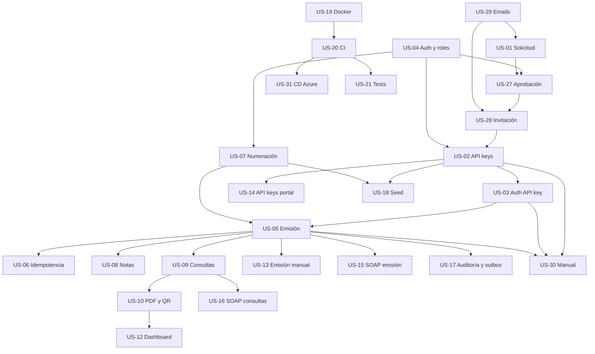

# Historias de usuario

El alcance obligatorio tiene **26 historias y 47 días ideales de trabajo**, y **se implementan en un único sprint**. US-19, US-20 y US-31 están completadas y archivadas; quedan 23 historias activas.

Las US-22 a US-25 **quedan fuera del alcance del proyecto** y están archivadas en [`docs/historias-usuario-fuera-de-alcance/`](../historias-usuario-fuera-de-alcance/README.md). No se implementan ni se cuentan para el avance del MVP.

El sprint se ejecuta en **6 fases** que son, al mismo tiempo, el orden de implementación: las historias de una fase dependen de las anteriores. Dentro de una fase, las historias sin dependencia mutua se pueden tomar en paralelo.

Las US-27 a US-30 completan el onboarding profesional: solicitud pública, aprobación por administrador global, invitación por email y manual de integración. Los números no indican orden de implementación; el orden lo define la columna **Orden**.

> El proceso completo está documentado en [`docs/proceso-alta-empresa.md`](../proceso-alta-empresa.md). El manual para integradores está en [`docs/manual-integracion.md`](../manual-integracion.md).

## Documentos de referencia

| Documento | Para qué sirve |
| --- | --- |
| [`docs/contratos-api.md`](../contratos-api.md) | **Contrato transversal normativo**: catálogo de errores, roles, autenticación, idempotencia, paginación, emisión y endpoints. Si una historia y este documento se contradicen, manda el contrato. |
| [`docs/plan-implementacion.md`](../plan-implementacion.md) | **Plan maestro**: fases del sprint, paralelismo, prerrequisitos de infraestructura, condición de salida y checklists de demo y de entrega. |
| [`docs/modelos.md`](../modelos.md) | Forma de los datos en MongoDB: entidades, campos, colecciones e índices. |
| [`docs/requisitos-funcionales.md`](../requisitos-funcionales.md) | Qué debe hacer el sistema, con la trazabilidad RF ↔ US. |
| [`docs/historias-usuario-fuera-de-alcance/README.md`](../historias-usuario-fuera-de-alcance/README.md) | Historias archivadas que **no entran** en el alcance del proyecto (US-22 a US-25). |

## Índice

La columna **Orden** es la posición dentro del sprint. La columna **Contrato** indica si la historia ya tiene definido el contrato técnico completo (modelo de datos, endpoints, validaciones, casos de prueba y dependencias). Todas las historias del MVP lo tienen.

| Orden | ID | Historia | Épica | Fase | Prioridad | Días | Requisito | Estado | Contrato |
| --- | --- | --- | --- | --- | --- | --- | --- | --- | --- |
| 1 | [US-04](US-04-login-multiempresa.md) | Autenticación, roles y aislamiento multiempresa | Registro | 1 | Alta | 3 | RF-11 | Base implementada | Sí |
| 2 | [US-29](US-29-emails-transaccionales.md) | Notificaciones transaccionales por email | Registro | 1 | Alta | 2 | RF-26 | Parcial | Sí |
| 3 | [US-01](US-01-alta-contribuyente.md) | Solicitud pública de alta de empresa | Registro | 2 | Alta | 2 | RF-23 | Parcial | Sí |
| 4 | [US-27](../historias-usuario-terminadas/US-27-aprobacion-solicitudes.md) | Revisión y aprobación de solicitudes | Registro | 2 | Alta | 3 | RF-24 | Completada | Sí |
| 5 | [US-28](../historias-usuario-terminadas/US-28-invitacion-cuenta.md) | Activación de cuenta por invitación | Registro | 2 | Alta | 2 | RF-25 | Completada | Sí |
| 6 | [US-02](US-02-api-keys.md) | Gestión de API keys | Integraciones | 3 | Alta | 2 | RF-02 | Pendiente | Sí |
| 7 | [US-03](US-03-autenticacion-api-key.md) | Autenticación por API key | Integraciones | 3 | Alta | 1 | RF-03 | Pendiente | Sí |
| 8 | [US-07](US-07-numeracion-atomica.md) | Numeración atómica | Emisión | 3 | Alta | 1 | RF-06 | Pendiente | Sí |
| 9 | [US-18](US-18-parametros-seed.md) | Parámetros y datos semilla | Operación | 3 | Media | 1 | RF-18 | Pendiente | Sí |
| 10 | [US-05](US-05-emision-facturas.md) | Emisión de facturas A, B y C | Emisión | 4 | Alta | 3 | RF-04 | Pendiente | Sí |
| 11 | [US-06](US-06-idempotencia.md) | Idempotencia de emisión | Emisión | 4 | Alta | 1 | RF-05 | Pendiente | Sí |
| 12 | [US-08](US-08-notas-credito-debito.md) | Notas de crédito y débito | Emisión | 4 | Alta | 2 | RF-07 | Pendiente | Sí |
| 13 | [US-09](US-09-consultas-comprobantes.md) | Consultas y último autorizado | Consultas | 5 | Alta | 1 | RF-08 | Pendiente | Sí |
| 14 | [US-10](US-10-pdf-qr.md) | PDF con código QR | Documentos | 5 | Alta | 2 | RF-09 | Pendiente | Sí |
| 15 | [US-12](US-12-dashboard-listado.md) | Dashboard y listado | Portal | 5 | Media | 2 | RF-13 | Pendiente | Sí |
| 16 | [US-13](US-13-emision-manual.md) | Emisión manual desde el portal | Portal | 5 | Media | 2 | RF-12 | Pendiente | Sí |
| 17 | [US-14](US-14-api-keys-portal.md) | API keys desde el portal | Portal | 5 | Media | 1 | RF-14 | Pendiente | Sí |
| 18 | [US-15](US-15-soap-emision.md) | SOAP de emisión | Interoperabilidad | 6 | Alta | 2 | RF-15 | Pendiente | Sí |
| 19 | [US-16](US-16-soap-consultas.md) | SOAP de consultas | Interoperabilidad | 6 | Media | 1 | RF-16 | Pendiente | Sí |
| 20 | [US-17](US-17-auditoria-outbox.md) | Auditoría y outbox | Operación | 6 | Media | 2 | RF-17 | Pendiente | Sí |
| 21 | [US-30](US-30-manual-integracion.md) | Manual online de integración | Portal | 6 | Media | 1 | RF-27 | Pendiente | Sí |
| 22 | [US-21](US-21-tests-documentacion.md) | Tests, Postman y documentación | Calidad | 6 | Alta | 2 | RNF-13/17/18 | Parcial | Sí |
| 23 | [US-11](US-11-verificacion-publica.md) | Verificación pública por CAE | Consultas | 6 | Alta | 2 | RF-10 | Base implementada | Sí |
| — | [US-19](../historias-usuario-terminadas/US-19-docker-compose.md) | Docker y Docker Compose | Infraestructura | — | Alta | 2 | RF-21 | Completada | — |
| — | [US-20](../historias-usuario-terminadas/US-20-integracion-continua.md) | Integración continua (CI) | Infraestructura | — | Alta | 1 | RF-21 | Completada | — |
| — | [US-31](../historias-usuario-terminadas/US-31-entrega-continua-azure.md) | Entrega continua y despliegue en Azure | Infraestructura | — | Alta | 3 | RNF-20 / RF-21 | Completada | — |

### Estado real de la implementación

Al día de hoy **US-11 y US-04 tienen comportamiento implementado**: la API expone `GET /`, `GET /health`, `GET /health/live`, `GET /v1/comprobantes/verificar/{cae}`, `POST /v1/auth/login`, `POST /v1/auth/logout`, `GET /v1/auth/me`, `POST /v1/admin/auth/login`, `POST /v1/admin/auth/logout` y `GET /v1/admin/auth/me`; el portal expone `/verificar`, `/login`, `/logout`, `/admin/login`, `/admin/logout` y `/admin`. US-04 queda en **Base implementada** porque el aislamiento multiempresa se completa con los endpoints de negocio de US-02, US-05 y US-09.

**US-29** queda en **Parcial**: el servicio de email está implementado y probado —`IEmailSender`, `EmailService`, las cinco plantillas, remitente de archivo en desarrollo, remitente SMTP y validación de configuración al arrancar—, pero falta el disparo desde los endpoints de US-01 y US-27 y la advertencia/reenvío en el panel de solicitudes.

**US-01** queda en **Parcial**: `POST /v1/solicitudes-alta` y la página `/solicitar-alta` están implementados y cubiertos por tests automáticos (unitarios y de integración); falta la verificación con Mongo real y el QA del camino feliz.

**US-27** queda **Completada**: la consola global lista, filtra, edita, aprueba, rechaza y reenvía invitaciones (`/v1/admin/solicitudes` y `/admin/solicitudes` en el portal). La aprobación crea contribuyente, punto de venta e invitación en una transacción de MongoDB y dispara los emails de US-29 después del commit.

**US-28** queda **Completada**: el link del email abre `/activar`, valida el token (`GET /v1/invitaciones/{token}`) y crea el usuario administrador de la empresa en una transacción que marca la invitación como usada (`POST /v1/invitaciones/{token}/aceptar`). Con US-01, US-27 y US-28 el onboarding funciona de punta a punta.

El resto de las historias tiene el **modelo de dominio y los índices de MongoDB preparados**, pero sin casos de uso, endpoints ni pantallas. Eso no cuenta como avance: una historia está terminada cuando entrega comportamiento verificable con test.

### Condición de salida del sprint

El sprint no está terminado hasta que **un grupo externo pueda integrarse sin ayuda**. Con las 23 historias del MVP cerradas, este es el recorrido que tiene que funcionar de punta a punta:

1. El compañero externo solicita el alta con su CUIT y su email (`US-01`).
2. Un `SuperAdmin` aprueba la solicitud en la consola global (`US-27`).
3. El compañero recibe el email con el enlace de activación y define su contraseña (`US-29`, `US-28`).
4. Inicia sesión en el portal y genera su API key (`US-04`, `US-14`, `US-02`).
5. Usa la API key para emitir un comprobante (`US-03`, `US-07`, `US-05`).
6. Reintenta la emisión con la misma `Idempotency-Key` y recibe el mismo comprobante (`US-06`).
7. Lista sus comprobantes, descarga el PDF y consulta el último autorizado (`US-09`, `US-10`).
8. Encuentra el manual de integración y la colección de Postman (`US-30`, `US-21`).
9. Verifica su comprobante por CAE desde el portal (`US-11`).

Ese recorrido es el criterio de avance del sprint. Si alguna historia del recorrido no está cerrada, el sprint todavía no terminó.

## Dependencias

| Historia | Depende de | Habilita |
| --- | --- | --- |
| US-01 | US-29 | US-27 |
| US-02 | US-04, US-28 | US-03, US-14, US-18 |
| US-03 | US-02 | US-05, US-09, US-15, US-16 |
| US-04 | — | US-02, US-05, US-07, US-12, US-13, US-14, US-27, US-28 |
| US-05 | US-03, US-07 | US-06, US-08, US-09, US-11, US-13, US-17, US-18, US-21 |
| US-06 | US-05 | US-21 |
| US-07 | US-04 | US-05, US-08, US-18 |
| US-08 | US-05 | US-09, US-10, US-12, US-13 |
| US-09 | US-03, US-05 | US-10, US-12, US-16, US-21 |
| US-10 | US-05, US-09 | US-12, US-13, US-21 |
| US-11 | US-05, US-18 (flujo completo) | US-10, US-30 |
| US-12 | US-04, US-09, US-10 | US-21 |
| US-13 | US-04, US-05, US-10 | US-21 |
| US-14 | US-02, US-04, US-28 | US-21, US-30 |
| US-15 | US-03, US-05 | US-16, US-21 |
| US-16 | US-03, US-09 | US-21 |
| US-17 | US-05, US-27, US-28 | US-30 |
| US-18 | US-02, US-04, US-07 | US-11, US-21 |
| US-19 | — | US-20 |
| US-20 | US-19 | US-21, US-31 |
| US-21 | Todas las implementadas; CI depende de US-20 y CD de US-31 | — |
| US-27 | US-01, US-04, US-29 | US-28 |
| US-28 | US-04, US-27, US-29 | US-02, US-14 |
| US-29 | US-19 | US-01, US-27, US-28 |
| US-30 | US-02, US-03, US-05 | US-21 |
| US-31 | US-19, US-20 | US-21 |

## Fases del sprint

Las fases son el orden de implementación, no sprints separados. Dentro de una fase, las historias marcadas como paralelas se pueden tomar al mismo tiempo.

| Fase | Nombre | Historias | Paralelismo |
| --- | --- | --- | --- |
| 1 | Base de acceso | US-04, US-29 | US-04 y US-29 en paralelo |
| 2 | Onboarding de empresas | US-01, US-27, US-28 | Secuencial: US-01 → US-27 → US-28 |
| 3 | Integraciones y numeración | US-02, US-03, US-07, US-18 | US-02 → US-03 en secuencia; US-07 y US-18 en paralelo |
| 4 | Emisión | US-05, US-06, US-08 | US-05 primero; US-06 y US-08 en paralelo |
| 5 | Consultas, documentos y portal | US-09, US-10, US-12, US-13, US-14 | US-09 → US-10; US-12, US-13 y US-14 en paralelo |
| 6 | Interoperabilidad, operación y entrega | US-15, US-16, US-17, US-30, US-21, US-11 | US-15, US-16, US-17 y US-30 en paralelo; US-21 y US-11 al final |

El plan detallado, con prerrequisitos de infraestructura, checklists de demo y de entrega, está en [`docs/plan-implementacion.md`](../plan-implementacion.md).

## Grafo simplificado

## Reglas de lectura

1. Leer este índice y solo la historia solicitada.
2. Verificar las dependencias antes de implementar.
3. Si falta una dependencia, detenerse y reportar el bloqueo; no inventar un atajo.
4. Implementar solo el alcance de la historia.
5. Respetar [`docs/contratos-api.md`](../contratos-api.md): si la historia y el contrato se contradicen, manda el contrato.
6. Marcar un checkbox solo con evidencia verificable.
7. Al completar todos los criterios y el Definition of Done, mover el archivo a `historias-usuario-terminadas/` y actualizar este índice.
8. No implementar historias fuera de alcance sin pedido explícito; están archivadas en `docs/historias-usuario-fuera-de-alcance/`.

## Leyenda de estado

- **Pendiente:** no implementada.
- **Base implementada:** existe el esqueleto funcional, falta completar la historia.
- **Parcial:** parte de la historia está cubierta.
- **Completada:** todos los criterios y el Definition of Done están verificados.
- **Fuera de alcance:** archivada en `docs/historias-usuario-fuera-de-alcance/`; no se implementa salvo pedido explícito.

La columna **Contrato** es independiente del estado: `Sí` significa que la historia tiene su contrato técnico definido y listo para implementar, no que la funcionalidad exista.
