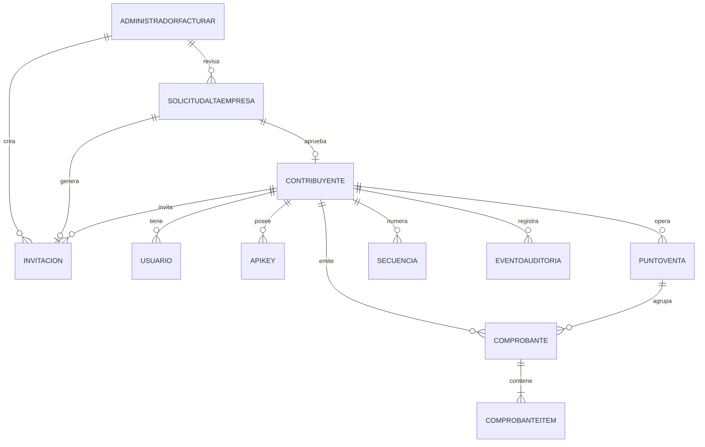

# Modelo de datos

## Enfoque

El dominio se modela con entidades ricas en datos y un conjunto acotado de reglas. MongoDB es la única persistencia. Las entidades usan `Guid` como identificador para simplificar la generación en aplicación y evitar acoplar el dominio a MongoDB.

Convenciones:

- Fechas en UTC.
- Montos con `decimal`; el driver de MongoDB los persiste como `Decimal128`.
- Nombres de propiedades en inglés; documentación y mensajes en español.
- El emisor se denormaliza en el comprobante para conservar los datos históricos.

## Entidades

### Contribuyente

Representa la empresa o persona que emite comprobantes.

| Campo | Tipo | Obligatorio | Notas |
| --- | --- | --- | --- |
| `Id` | `Guid` | Sí | Clave primaria. |
| `Cuit` | `string` | Sí | 11 dígitos, único, dígito verificador válido. |
| `RazonSocial` | `string` | Sí | Nombre fiscal. |
| `CondicionIva` | `CondicionIva` | Sí | Condición frente al IVA. |
| `Email` | `string?` | No | Contacto. |
| `Activo` | `bool` | Sí | Baja lógica. |
| `CreatedAt` | `DateTime` | Sí | UTC. |

### Usuario

Usuario del portal asociado a un contribuyente.

| Campo | Tipo | Obligatorio | Notas |
| --- | --- | --- | --- |
| `Id` | `Guid` | Sí | Clave primaria. |
| `ContribuyenteId` | `Guid` | Sí | Tenant. |
| `Email` | `string` | Sí | Único por contribuyente. |
| `PasswordHash` | `string` | Sí | Nunca contraseña en texto plano. |
| `Rol` | `RolUsuario` | Sí | Administrador, Emisor o Consulta. |
| `Activo` | `bool` | Sí | Baja lógica. |
| `EmailVerificadoAt` | `DateTime?` | No | Se completa al aceptar la invitación. |
| `UltimoAcceso` | `DateTime?` | No | Último login exitoso. |
| `CreatedAt` | `DateTime` | Sí | UTC. |

### AdministradorFacturar

Administrador global de la plataforma. No pertenece a un contribuyente.

| Campo | Tipo | Obligatorio | Notas |
| --- | --- | --- | --- |
| `Id` | `Guid` | Sí | Clave primaria. |
| `Nombre` | `string` | Sí | Nombre visible. |
| `Email` | `string` | Sí | Único, normalizado. |
| `PasswordHash` | `string` | Sí | Nunca contraseña en texto plano. |
| `Rol` | `RolGlobal` | Sí | SuperAdmin o Soporte. |
| `Activo` | `bool` | Sí | Baja lógica. |
| `UltimoAcceso` | `DateTime?` | No | Último login exitoso. |
| `CreatedAt` | `DateTime` | Sí | UTC. |

### SolicitudAltaEmpresa

Solicitud pública de alta de una empresa. No crea el contribuyente hasta la aprobación.

| Campo | Tipo | Obligatorio | Notas |
| --- | --- | --- | --- |
| `Id` | `Guid` | Sí | Clave primaria. |
| `RazonSocial` | `string` | Sí | Nombre fiscal declarado. |
| `Cuit` | `string` | Sí | Normalizado, dígito verificador válido. |
| `CondicionIva` | `CondicionIva` | Sí | Condición declarada. |
| `NombreSolicitante` | `string` | Sí | Persona de contacto. |
| `EmailSolicitante` | `string` | Sí | Normalizado a minúsculas. |
| `Telefono` | `string` | Sí | Contacto. |
| `Domicilio` | `string` | Sí | Dirección. |
| `Ciudad` | `string` | Sí | Ciudad. |
| `Provincia` | `string` | Sí | Provincia. |
| `CodigoPostal` | `string` | Sí | Código postal. |
| `Mensaje` | `string?` | No | Comentario del solicitante. |
| `AceptaTerminos` | `bool` | Sí | Debe ser verdadero. |
| `TerminosAceptadosAt` | `DateTime` | Sí | UTC. |
| `Estado` | `EstadoSolicitud` | Sí | Pendiente, Aprobada o Rechazada. |
| `MotivoRechazo` | `string?` | No | Obligatorio al rechazar. |
| `ContribuyenteId` | `Guid?` | No | Se completa al aprobar. |
| `InvitacionId` | `Guid?` | No | Invitación creada al aprobar. |
| `RevisadaPorAdministradorId` | `Guid?` | No | Administrador global. |
| `RevisadaAt` | `DateTime?` | No | UTC. |
| `CreatedAt` | `DateTime` | Sí | UTC. |
| `UpdatedAt` | `DateTime` | Sí | UTC. |

### Invitacion

Invitación de un solo uso para activar una cuenta de empresa.

| Campo | Tipo | Obligatorio | Notas |
| --- | --- | --- | --- |
| `Id` | `Guid` | Sí | Clave primaria. |
| `ContribuyenteId` | `Guid` | Sí | Empresa a activar. |
| `SolicitudId` | `Guid?` | No | Solicitud que la originó. |
| `Email` | `string` | Sí | Destinatario, normalizado. |
| `Rol` | `RolUsuario` | Sí | Administrador por defecto. |
| `TokenHash` | `string` | Sí | Hash del token; nunca el token completo. |
| `TokenPrefix` | `string` | Sí | Prefijo visible para soporte. |
| `Estado` | `EstadoInvitacion` | Sí | `Pendiente` al crear. `Vencida` se deriva de `ExpiraAt` al leer; no se persiste. |
| `ExpiraAt` | `DateTime` | Sí | UTC, 48 horas desde la creación. |
| `UsadaAt` | `DateTime?` | No | UTC. |
| `RevocadaAt` | `DateTime?` | No | UTC. |
| `CreadaPorAdministradorId` | `Guid` | Sí | Administrador global. |
| `UltimoEnvioAt` | `DateTime?` | No | UTC. |
| `IntentosEnvio` | `int` | Sí | Contador. |
| `CreatedAt` | `DateTime` | Sí | UTC. |

### ApiKey

Credencial para integraciones externas.

| Campo | Tipo | Obligatorio | Notas |
| --- | --- | --- | --- |
| `Id` | `Guid` | Sí | Clave primaria. |
| `ContribuyenteId` | `Guid` | Sí | Tenant. |
| `Nombre` | `string` | Sí | Descripción para el usuario. |
| `Prefix` | `string` | Sí | Prefijo visible, único. |
| `Hash` | `string` | Sí | Hash de la clave completa. |
| `Activa` | `bool` | Sí | Revocación lógica. |
| `RevocadaAt` | `DateTime?` | No | UTC. |
| `RegeneradaAt` | `DateTime?` | No | UTC. |
| `CreatedAt` | `DateTime` | Sí | UTC. |
| `UltimoUso` | `DateTime?` | No | Última autenticación exitosa. |

### PuntoVenta

Punto de emisión de un contribuyente.

| Campo | Tipo | Obligatorio | Notas |
| --- | --- | --- | --- |
| `Id` | `Guid` | Sí | Clave primaria. |
| `ContribuyenteId` | `Guid` | Sí | Tenant. |
| `Numero` | `int` | Sí | Único por contribuyente. |
| `Descripcion` | `string` | Sí | Nombre del punto. |
| `Activo` | `bool` | Sí | Baja lógica. |
| `CreatedAt` | `DateTime` | Sí | UTC. |

### Secuencia

Contador atómico por contribuyente, punto de venta y tipo.

| Campo | Tipo | Obligatorio | Notas |
| --- | --- | --- | --- |
| `Id` | `Guid` | Sí | Clave primaria. |
| `ContribuyenteId` | `Guid` | Sí | Tenant. |
| `PuntoVenta` | `int` | Sí | Parte de la clave lógica. |
| `TipoComprobante` | `TipoComprobante` | Sí | Parte de la clave lógica. |
| `UltimoNumero` | `long` | Sí | Último número asignado. |

La asignación se realiza con `findOneAndUpdate` y `$inc`, dentro de una transacción junto con la inserción del comprobante. La secuencia se crea de forma implícita en la primera emisión con `UltimoNumero = 0`; el primer número es `1`.

### Comprobante

Documento fiscal emitido.

| Campo | Tipo | Obligatorio | Notas |
| --- | --- | --- | --- |
| `Id` | `Guid` | Sí | Clave primaria. |
| `ContribuyenteId` | `Guid` | Sí | Tenant. |
| `EmisorCuit` | `string` | Sí | Copia histórica. |
| `EmisorRazonSocial` | `string` | Sí | Copia histórica. |
| `PuntoVenta` | `int` | Sí | Punto de emisión. |
| `TipoComprobante` | `TipoComprobante` | Sí | Código AFIP. |
| `Numero` | `long` | Sí | Correlativo. |
| `FechaEmision` | `DateTime` | Sí | UTC. |
| `Cae` | `string` | Sí | 14 dígitos, único. |
| `CaeVencimiento` | `DateTime` | Sí | Emisión + 10 días. |
| `ReceptorDocumentoTipo` | `string` | Sí | `99` para consumidor final. |
| `ReceptorDocumentoNumero` | `string` | Sí | CUIT/DNI del receptor. |
| `ReceptorRazonSocial` | `string` | Sí | Nombre o razón social. |
| `ReceptorCondicionIva` | `CondicionIva` | Sí | Condición del receptor. |
| `ImporteNeto` | `decimal` | Sí | Base imponible. |
| `ImporteIva` | `decimal` | Sí | IVA. |
| `ImporteTotal` | `decimal` | Sí | Neto + IVA. |
| `Moneda` | `string` | Sí | `ARS` por defecto. |
| `Estado` | `EstadoComprobante` | Sí | Emitido, anulado, etc. |
| `IdempotencyKey` | `string` | Sí | Única por contribuyente. |
| `Observaciones` | `string?` | No | Texto libre. |
| `Items` | `List<ComprobanteItem>` | Sí | Detalle. |
| `CreatedAt` | `DateTime` | Sí | UTC. |

### ComprobanteItem

| Campo | Tipo | Obligatorio | Notas |
| --- | --- | --- | --- |
| `Descripcion` | `string` | Sí | Detalle del ítem. |
| `Cantidad` | `decimal` | Sí | Mayor que cero. |
| `PrecioUnitario` | `decimal` | Sí | Mayor o igual a cero. |
| `AlicuotaIva` | `decimal` | Sí | Porcentaje, por ejemplo `21`. |
| `Subtotal` | `decimal` | Sí | Cantidad × precio. |

### OutboxMessage

Cola transaccional para eventos y notificaciones.

| Campo | Tipo | Obligatorio | Notas |
| --- | --- | --- | --- |
| `Id` | `Guid` | Sí | Clave primaria. |
| `Tipo` | `string` | Sí | Tipo de evento. |
| `Payload` | `string` | Sí | JSON serializado. |
| `Estado` | `string` | Sí | `Pendiente`, `Procesado`, `Fallido`. |
| `Intentos` | `int` | Sí | Reintentos. |
| `CreatedAt` | `DateTime` | Sí | UTC. |
| `ProcesadoAt` | `DateTime?` | No | UTC. |
| `Error` | `string?` | No | Último error. |

### EmailMessage

Registro de un email transaccional compuesto y su resultado de envío.

| Campo | Tipo | Obligatorio | Notas |
| --- | --- | --- | --- |
| `Id` | `Guid` | Sí | Clave primaria. |
| `Para` | `string` | Sí | Destinatario. |
| `Asunto` | `string` | Sí | Asunto renderizado. |
| `CuerpoHtml` | `string?` | No | HTML escapado; se omite o redacta si contiene un token. |
| `CuerpoTexto` | `string?` | No | Alternativa en texto plano; misma regla. |
| `Plantilla` | `string` | Sí | Nombre de la plantilla. |
| `Estado` | `string` | Sí | `Pendiente`, `Enviado`, `Fallido`. |
| `Intentos` | `int` | Sí | Reintentos. |
| `UltimoError` | `string?` | No | Sin secretos. |
| `CreatedAt` | `DateTime` | Sí | UTC. |
| `EnviadoAt` | `DateTime?` | No | UTC. |

En desarrollo el remitente puede escribir el contenido en un archivo en lugar de persistirlo. Para emails con token, el cuerpo se renderiza en memoria y se persiste redactado o no se persiste; el token completo nunca queda en `EmailMessage`, logs ni auditoría. El archivo de desarrollo que contiene el link debe tratarse como secreto local.

### EventoAuditoria

| Campo | Tipo | Obligatorio | Notas |
| --- | --- | --- | --- |
| `Id` | `Guid` | Sí | Clave primaria. |
| `ContribuyenteId` | `Guid?` | No | Tenant; nulo para acciones globales. |
| `UsuarioId` | `Guid?` | No | Actor de empresa. |
| `AdministradorId` | `Guid?` | No | Actor global. |
| `ActorTipo` | `string` | Sí | `Empresa`, `Administrador` o `Sistema`. |
| `Accion` | `string` | Sí | Verbo de negocio. |
| `Entidad` | `string` | Sí | Entidad afectada. |
| `EntidadId` | `string?` | No | Identificador. |
| `Datos` | `string?` | No | JSON de contexto sin secretos. |
| `CreatedAt` | `DateTime` | Sí | UTC. |

## Enumeraciones

### TipoComprobante

| Valor | Código | Descripción |
| --- | --- | --- |
| `FacturaA` | 1 | Factura A |
| `NotaDebitoA` | 2 | Nota de Débito A |
| `NotaCreditoA` | 3 | Nota de Crédito A |
| `FacturaB` | 6 | Factura B |
| `NotaDebitoB` | 7 | Nota de Débito B |
| `NotaCreditoB` | 8 | Nota de Crédito B |
| `FacturaC` | 11 | Factura C |
| `NotaDebitoC` | 12 | Nota de Débito C |
| `NotaCreditoC` | 13 | Nota de Crédito C |

### CondicionIva

| Valor | Código |
| --- | --- |
| `ResponsableInscripto` | 1 |
| `Exento` | 4 |
| `ConsumidorFinal` | 5 |
| `Monotributo` | 6 |
| `SujetoNoCategorizado` | 7 |

### EstadoComprobante

| Valor | Código |
| --- | --- |
| `Borrador` | 0 |
| `Emitido` | 1 |
| `Anulado` | 2 |
| `Rechazado` | 3 |

### RolUsuario

| Valor | Código |
| --- | --- |
| `Administrador` | 1 |
| `Emisor` | 2 |
| `Consulta` | 3 |

### RolGlobal

| Valor | Código | Permisos |
| --- | --- | --- |
| `SuperAdmin` | 1 | Ver, editar, aprobar, rechazar y reenviar. |
| `Soporte` | 2 | Ver y reenviar invitaciones. |

### EstadoSolicitud

| Valor | Descripción |
| --- | --- |
| `Pendiente` | Recibida y pendiente de revisión. |
| `Aprobada` | Contribuyente, punto de venta e invitación creados. |
| `Rechazada` | Revisada y rechazada con motivo. |

### EstadoInvitacion

| Valor | Descripción |
| --- | --- |
| `Pendiente` | Vigente y sin usar. |
| `Usada` | Cuenta creada. |
| `Vencida` | Superó la fecha de expiración. |
| `Revocada` | Reemplazada o anulada. |

## Relaciones



## Colecciones e índices

| Colección | Índice | Tipo |
| --- | --- | --- |
| `contribuyentes` | `Cuit` | Único |
| `usuarios` | `ContribuyenteId + Email` | Único |
| `administradores` | `Email` | Único |
| `solicitudesAlta` | `Cuit` con `Estado = Pendiente` | Único parcial |
| `solicitudesAlta` | `EmailSolicitante` con `Estado = Pendiente` | Único parcial |
| `solicitudesAlta` | `Estado + CreatedAt` | Compuesto |
| `invitaciones` | `TokenHash` | Único |
| `invitaciones` | `ContribuyenteId + Email + ExpiraAt` | Compuesto |
| `invitaciones` | `ExpiraAt` | Simple |
| `apiKeys` | `Prefix` | Único |
| `puntosVenta` | `ContribuyenteId + Numero` | Único |
| `secuencias` | `ContribuyenteId + PuntoVenta + TipoComprobante` | Único |
| `comprobantes` | `Cae` | Único |
| `comprobantes` | `ContribuyenteId + PuntoVenta + TipoComprobante + Numero` | Único |
| `comprobantes` | `ContribuyenteId + IdempotencyKey` | Único |
| `comprobantes` | `ContribuyenteId + FechaEmision` | Compuesto |
| `comprobantes` | `ReceptorDocumentoNumero` | Simple |
| `outbox` | `Estado + CreatedAt` | Compuesto |
| `emails` | `Estado + CreatedAt` | Compuesto |
| `eventos` | `ContribuyenteId + CreatedAt` | Compuesto |
| `eventos` | `AdministradorId + CreatedAt` | Compuesto |

La inicialización se ejecuta al arrancar la API si `Mongo__InitializeIndexes=true`.

## Validaciones

- `CuitValidator` normaliza separadores y valida el dígito verificador.
- `CaeValidator` exige exactamente 14 dígitos.
- `CaeGenerator` genera 14 dígitos aleatorios con primer dígito distinto de cero.
- El vencimiento del CAE es la fecha de emisión más 10 días.
- No se permiten montos negativos salvo en notas de crédito, que se modelan con su propio tipo.
- El email se normaliza a minúsculas y se valida con formato.
- La contraseña exige al menos 10 caracteres, una letra y un número; no se guarda en texto plano.
- El token de invitación se genera con alta entropía, se muestra una vez y se persiste solo su hash.
- La invitación vence a las 48 horas y no puede reutilizarse.
- Una solicitud pendiente es única por CUIT y por email.
- La aprobación se ejecuta en una transacción: crea contribuyente, punto de venta, invitación y actualiza la solicitud.
- Una solicitud aprobada o rechazada no se vuelve a procesar.
- El rechazo exige un motivo.
- Las transiciones de estado de la invitación son `Pendiente` a `Usada`, `Vencida` o `Revocada`.
- La activación crea el usuario con el `ContribuyenteId` y el rol de la invitación; el email no se puede cambiar.
- Las acciones globales usan `ContribuyenteId = null` en la auditoría y registran `AdministradorId`.

## Contrato de verificación

`GET /v1/comprobantes/verificar/{cae}` devuelve:

```json
{
  "cae": "12345678901234",
  "cuitEmisor": "20123456786",
  "razonSocialEmisor": "Empresa de Prueba S.A.",
  "tipoComprobante": 1,
  "tipoComprobanteDescripcion": "Factura A",
  "puntoVenta": 1,
  "numero": 42,
  "fechaEmision": "2026-10-25T00:00:00Z",
  "importeTotal": 121000,
  "moneda": "ARS",
  "estado": "Emitido",
  "caeVencimiento": "2026-11-04T00:00:00Z"
}
```

Errores:

- `400 CAE_INVALIDO`: el CAE no tiene 14 dígitos.
- `404 COMPROBANTE_NO_ENCONTRADO`: no existe un comprobante con ese CAE.

## Estado de implementación

Implementado en esta base:

- Entidades y enums existentes: `Contribuyente`, `Usuario`, `ApiKey`, `PuntoVenta`, `Secuencia`, `Comprobante`, `ComprobanteItem`, `OutboxMessage`, `EventoAuditoria`; enums `CondicionIva`, `EstadoComprobante`, `RolUsuario` y `TipoComprobante`.
- Validación de CUIT y CAE.
- Generación de CAE simulado.
- Colecciones, índices y repositorio de comprobantes.
- Verificación pública por CAE.

Documentado y pendiente de implementación:

- `AdministradorFacturar`, `SolicitudAltaEmpresa`, `Invitacion`, `EmailMessage` y `Webhook`/`WebhookEntrega` (US-23, fuera de alcance).
- Enums `RolGlobal`, `EstadoSolicitud` y `EstadoInvitacion`.
- Solicitud pública, aprobación, invitación, activación y emails.
- Autenticación de empresa y administrador global.
- API keys, emisión con transacción, idempotencia y numeración atómica.
- Notas de crédito/débito.
- PDF, SOAP, auditoría y outbox.
