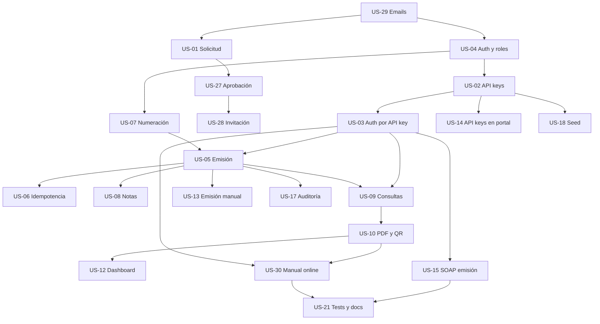

# Plan de implementación

Este documento es el plan maestro de FacturAR: el orden en que se implementan las historias, los prerrequisitos que hay que levantar antes de empezar, las reglas que no se negocian y las listas de verificación para la demo y para la entrega a un grupo consumidor de la API.

Complementa tres documentos:

| Documento | Rol |
| --- | --- |
| [`docs/contratos-api.md`](contratos-api.md) | Contrato normativo de la API. Si una historia y este documento se contradicen, manda el contrato. |
| [`docs/historias-usuario/README.md`](historias-usuario/README.md) | Índice de historias, dependencias y estados. |
| [`docs/modelos.md`](modelos.md) | Forma de los datos en MongoDB. |

## 1. Objetivo del MVP

Al terminar, el sistema tiene que permitir esta cadena completa, sin pasos manuales:

1. Una empresa solicita el alta (público, sin registro libre).
2. Un administrador global revisa y aprueba la solicitud.
3. La empresa recibe un email con el link de activación y define su contraseña.
4. El administrador de la empresa crea una API key desde el portal.
5. Una aplicación externa emite un comprobante con la API key.
6. La misma aplicación consulta el comprobante y descarga el PDF.
7. Un visitante verifica el comprobante por CAE, sin autenticación.
8. Todo queda auditado.

**Criterio de éxito:** un grupo externo, con solo el manual y una API key, puede emitir y consultar comprobantes sin acceso al código ni a la base de datos.

## 2. Decisiones de plataforma

| Decisión | Motivo |
| --- | --- |
| Azure App Service (Web Apps para contenedor Linux, plan B1) | Despliegue gestionado, Always On, TLS automático, health check nativo y costo bajo. Cubre RNF-20. |
| MongoDB Atlas M0 | Ya es replica set, requisito de las transacciones de US-05, US-07 y US-08. |
| Docker Hub público con tags inmutables por SHA | El deploy nunca usa `latest`. Permite rollback instantáneo a cualquier versión. |
| GitHub Actions con CI y CD separados | La CD solo se dispara si la CI del mismo commit fue exitosa. |
| **Sin Kubernetes** | Decisión fechada: el proyecto es académico, lo consumen 1 a 3 aplicaciones externas y no hay requisito de escala horizontal. Ver la decisión en [`docs/historias-usuario/US-26-kubernetes.md`](historias-usuario/US-26-kubernetes.md). |
| **Sin ACR ni Azure Container Apps** | Docker Hub alcanza y no agrega costo. |

## 3. Estado real al inicio del plan

Al momento de escribir este plan, de las 23 historias activas del MVP **solo US-11 (verificación pública por CAE) tiene funcionalidad implementada**. El resto tiene el modelo de dominio y los índices de MongoDB preparados, pero no hay casos de uso, endpoints ni pantallas.

Existe un riesgo de Perception Brecha: las entidades y los índices dan la impresión de que la funcionalidad está hecha. No lo está. Cada historia debe entregar comportamiento verificable, no solo estructura.

## 4. Prerrequisitos de infraestructura

Estos puntos bloquean historias concretas. Hay que resolverlos **antes** de empezar la historia que depende de ellos.

| Prerrequisito | Bloquea | Acción | Responsable |
| --- | --- | --- | --- |
| MongoDB local como replica set | US-05, US-07, US-08 | Agregar `--replSet rs0` al servicio `mongo` de `docker-compose.yml` e inicializarlo con `rs.initiate()`. Atlas M0 ya es replica set. | Infra |
| Health check path de Azure en `/health/live` | Operación | `az webapp config set --health-check-path /health/live` en ambas Web Apps. Evita que una caída transitoria de Atlas reinicie el contenedor en loop. | Infra |
| `SOURCE_COMMIT` y `APP_VERSION` en el build | Operación | Ya resueltos: el CD los inyecta como build args. Los endpoints `/` y `/health` los informan. | Hecho |
| `MONGO_CONNECTION_STRING` de desarrollo | Todos los tests de integración | `.env` local o variable de entorno. Los tests `MongoFact` se omiten sin ella. | Todos |

## 5. Reglas transversales

Estas reglas aplican a todas las historias. Están en [`docs/contratos-api.md`](contratos-api.md) y no se renegocian por historia.

1. **El `ContribuyenteId` viene del contexto**, nunca del body ni del query string. Toda consulta de negocio filtra por él.
2. **El cuerpo de error es siempre `{ "codigo", "mensaje" }`** y el código sale del catálogo cerrado de `docs/contratos-api.md` §2. Un código nuevo requiere modificar ese catálogo en la misma historia.
3. **El acceso a datos de otra empresa devuelve `404`**, no `403`, para no revelar la existencia del recurso.
4. **`decimal` para dinero, `Decimal128` en Mongo, UTC para fechas, `CancellationToken` en toda operación asíncrona.**
5. **Los DTOs públicos van en `FacturAR.Contracts`.** No se exponen entidades ni campos internos.
6. **El portal nunca accede a MongoDB.** Consume la API por HTTP.
7. **Todo comportamiento nuevo lleva test.** Unitario para reglas, integración para endpoints, `MongoFact` para Mongo real.
8. **Ninguna historia marca un checkbox sin evidencia**: un test que pasa, un comando ejecutado, una QA o una prueba manual registrada con fecha.
9. **Ninguna historia avanza a la siguiente.** El orquestador corta si falta una dependencia.
10. **La documentación se actualiza en la misma historia** que cambia el comportamiento.

## 6. Orden de ejecución

### Fase 0 — Base de acceso

Objetivo: que exista una sesión, una API key y que la API pueda autenticar a un integrador.

| Historia | Depende de | Puede ir en paralelo con |
| --- | --- | --- |
| US-29 — Notificaciones por email | — | US-04 |
| US-04 — Autenticación, roles y aislamiento multiempresa | — | US-29 |
| US-02 — Gestión de API keys | US-04, US-28 | US-07, US-18 |
| US-03 — Autenticación por API key | US-02 | — |

**Salida de fase:** un usuario se loguea en el portal, crea una API key y un request con `X-Api-Key` resuelve el contribuyente correcto.

> US-02 depende de US-28 según el índice, pero el seeding de una API key de demo se resuelve en US-18. Si US-28 todavía no está, se implementa US-02 con el repositorio y se deja el alta desde el portal para US-14.

### Fase 1 — Onboarding profesional

Objetivo: que una empresa externa pueda.self-servicio pedir el alta y activarse.

| Historia | Depende de | Puede ir en paralelo con |
| --- | --- | --- |
| US-01 — Solicitud pública de alta | US-29 | US-27 |
| US-27 — Revisión y aprobación de solicitudes | US-01, US-04, US-29 | US-28 |
| US-28 — Activación de cuenta por invitación | US-04, US-27, US-29 | — |

**Salida de fase:** solicitud → aprobación → email con link → activación → sesión activa.

### Fase 2 — Emisión

Objetivo: que se emitan comprobantes correctos, numerados e idempotentes.

| Historia | Depende de | Puede ir en paralelo con |
| --- | --- | --- |
| US-07 — Numeración atómica | US-04 | US-02 |
| US-05 — Emisión de facturas A, B y C | US-03, US-07 | — |
| US-06 — Idempotencia de emisión | US-05 | US-08 |
| US-08 — Notas de crédito y débito | US-05 | US-06 |

**Salida de fase:** `POST /v1/comprobantes` emite con número correlativo, CAE único y `Idempotency-Key` funcional.

> US-05, US-07 y US-08 requieren transacciones. Sin replica set local, sus tests de concurrencia y rollback no pueden pasar. Resolver el prerrequisito de §4.

### Fase 3 — Consultas, documentos y portal

Objetivo: que el emisor y el integrador puedan consultar y descargar, y que el portal tenga la operación diaria.

| Historia | Depende de | Puede ir en paralelo con |
| --- | --- | --- |
| US-09 — Consultas y último autorizado | US-03, US-05 | US-10 |
| US-10 — PDF con código QR | US-05, US-09 | US-14 |
| US-12 — Dashboard y listado | US-04, US-09, US-10 | US-13 |
| US-13 — Emisión manual desde el portal | US-04, US-05, US-10 | US-14 |
| US-14 — API keys desde el portal | US-02, US-04, US-28 | US-12, US-13 |

**Salida de fase:** el portal tiene dashboard, listado, detalle con PDF y emisión manual. La API tiene listado, detalle, último autorizado y PDF.

### Fase 4 — Interoperabilidad y operación

Objetivo: interoperabilidad con el contrato de AFIP y trazabilidad interna.

| Historia | Depende de | Puede ir en paralelo con |
| --- | --- | --- |
| US-15 — SOAP de emisión | US-03, US-05 | US-16, US-17, US-18 |
| US-16 — SOAP de consultas | US-03, US-09 | US-15, US-17, US-18 |
| US-17 — Auditoría y outbox | US-05, US-27, US-28 | US-15, US-16, US-18 |
| US-18 — Parámetros y datos semilla | US-02, US-04, US-07 | US-15, US-16, US-17 |

**Salida de fase:** la API habla REST y SOAP, todo queda auditado y hay datos de demo para la presentación.

### Fase 5 — Cierre y entrega

| Historia | Depende de |
| --- | --- |
| US-30 — Manual online de integración | US-02, US-03, US-05 |
| US-21 — Tests, Postman y documentación | Todas las implementadas |

**Salida de fase:** un tercero puede integrar la API leyendo el manual y la colección de Postman, sin ayuda.

### Resumen visual

## 7. Checklist de demo end-to-end

Para la presentación y para la entrega a un grupo consumidor. Cada ítem tiene una historia asociada: si alguno falla, esa historia no está terminada.

- [ ] Un visitante envía una solicitud de alta con un CUIT válido y recibe `201`.
- [ ] Un `SuperAdmin` ve la solicitud en el panel y la aprueba.
- [ ] El solicitante recibe el email con el link de activación y la fecha de vencimiento.
- [ ] El solicitante define su contraseña, activa la cuenta e inicia sesión.
- [ ] El administrador de la empresa crea una API key y la ve una sola vez.
- [ ] Un `Emisor` emite una factura A desde el portal y recibe el PDF con el QR.
- [ ] Un integrador externo emite un comprobante con `X-Api-Key` e `Idempotency-Key`.
- [ ] El integrador reintenta el mismo request y recibe el mismo comprobante, sin duplicar ni renumerar.
- [ ] El integrador lista sus comprobantes y descarga el PDF de uno.
- [ ] Un visitante verifica el comprobante por CAE sin autenticarse.
- [ ] La búsqueda del CAE no expone `ContribuyenteId`, `IdempotencyKey` ni ítems.
- [ ] Una empresa no puede ver ni emitir para otra empresa.
- [ ] Todo el recorrido queda en la auditoría.

## 8. Checklist de cierre del proyecto

- [ ] Todas las historias obligatorias están en estado `Completada` y archivadas en `docs/historias-usuario-terminadas/`.
- [ ] `dotnet build FacturAR.slnx -c Release` compila sin advertencias.
- [ ] `dotnet test FacturAR.slnx -c Release --no-build` pasa, sin tests omitidos por falta de `MONGO_CONNECTION_STRING`.
- [ ] `dotnet format FacturAR.slnx --verify-no-changes` pasa.
- [ ] La CI en verde en `development` y en `main`.
- [ ] El CD despliega desde `main` con el SHA validado y el smoke test confirma el commit.
- [ ] La API y el portal responden en producción.
- [ ] El manual de integración describe solo endpoints que existen.
- [ ] La colección de Postman incluye todos los endpoints públicos.
- [ ] No hay secretos en el repositorio ni en la documentación.
- [ ] `docs/requisitos-funcionales.md` y `docs/requisitos-no-funcionales.md` reflejan el sistema final.

## 9. Entrega a un grupo consumidor de la API

Qué tiene que recibir el grupo externo y en qué orden.

| # | Entregable | Dónde | Estado |
| --- | --- | --- | --- |
| 1 | URL base de la API | `docs/despliegue-azure.md` §4.4 | En producción |
| 2 | Manual de integración | `docs/manual-integracion.md` y `/manual` del portal | US-30 |
| 3 | Catálogo de errores | `docs/contratos-api.md` §2 | Canónico |
| 4 | Formato de API key | `docs/manual-integracion.md` §Autenticación | US-02 |
| 5 | Colección Postman | `docs/postman/FacturAR.postman_collection.json` | US-21 |
| 6 | OpenAPI | `/openapi/v1.json` en Development | US-21 |
| 7 | Ejemplo de factura completa | `docs/manual-integracion.md` §Emisión | US-05 |
| 8 | Reglas de idempotencia | `docs/contratos-api.md` §5 | US-06 |
| 9 | Formato del PDF y del QR | `docs/contratos-api.md` §7 y US-10 | US-10 |
| 10 | Límites y rate limit | `docs/contratos-api.md` §2 | US-01, US-04 |
| 11 | Datos de prueba | Seed de US-18 | US-18 |
| 12 | Contacto para soporte | Definir antes de la entrega | A definir |

**Regla de oro para el grupo externo:** si algo no está en el manual, no está soportado. Cada línea del manual tiene que ser verificable contra la API desplegada.

## 10. Riesgos

| Riesgo | Impacto | Mitigación |
| --- | --- | --- |
| Las entidades e índices existen pero no hay comportamiento. Se percibe avance que no existe. | Alto | Cada historia entrega endpoint o pantalla verificable. La demo de §7 es el criterio de avance. |
| El equipo implementa en paralelo dos historias con contratos incompatibles. | Alto | `docs/contratos-api.md` es normativo. En la revisión de código, una desviación del contrato es un hallazgo `blocker`. |
| La CI queda roja por el entorno de MongoDB y frena la promoción. | Medio | `mongo:8.2` ya está fijado en `development`. Ante una falla de runner, fijar la versión de imagen del runner. |
| Replica set no disponible en local y los tests de concurrencia se omiten. | Alto | Prerrequisito de §4. Sin replica set, US-05, US-07 y US-08 no cierran. |
| El despliegue en `main` queda desactualizado respecto de `development`. | Medio | Promover con PR `development → main` después de cada bloque de historias. El CD despliega desde `main`. |
| Los documentos describen funcionalidad futura como si existiera. | Medio | El bloque de estado al inicio de `manual-integracion.md` y `proceso-alta-empresa.md` y el criterio de US-21 lo controlan. |
| El smoke test da verde falso con un contenedor viejo. | Medio | Resuelto: el smoke test compara el `commit` de `/health/live` con el SHA esperado. |
| Rollback automático nunca probado en un fallo real. | Medio | Está configurado y documentado como no probado. La reversión manual por `workflow_dispatch` sí está probada. |
