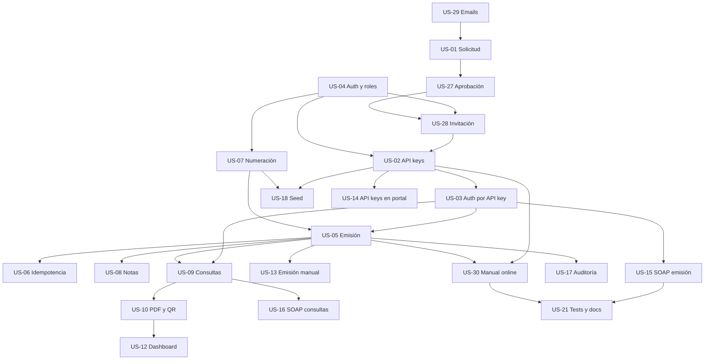

# Plan de implementación

Este documento es el plan maestro de FacturAR: el orden en que se implementan las historias, los prerrequisitos que hay que levantar antes de empezar, las reglas que no se negocian y las listas de verificación para la demo y para la entrega a un grupo consumidor de la API.

Complementa tres documentos:

| Documento | Rol |
| --- | --- |
| [`docs/contratos-api.md`](contratos-api.md) | Contrato normativo de la API. Si una historia y este documento se contradicen, manda el contrato. |
| [`docs/historias-usuario/README.md`](historias-usuario/README.md) | Índice de historias, dependencias y estados. |
| [`docs/modelos.md`](modelos.md) | Forma de los datos en MongoDB. |

## 1. Objetivo del MVP

Al terminar, el sistema tiene que permitir esta cadena completa, sin pasos manuales:

1. Una empresa solicita el alta (público, sin registro libre).
2. Un administrador global revisa y aprueba la solicitud.
3. La empresa recibe un email con el link de activación y define su contraseña.
4. El administrador de la empresa crea una API key desde el portal.
5. Una aplicación externa emite un comprobante con la API key.
6. La misma aplicación consulta el comprobante y descarga el PDF.
7. Un visitante verifica el comprobante por CAE, sin autenticación.
8. Todo queda auditado.

**Criterio de éxito:** un grupo externo, con solo el manual y una API key, puede emitir y consultar comprobantes sin acceso al código ni a la base de datos.

### El escenario concreto de arranque

El criterio anterior, traducido al caso real que hay que entregar: un compañero de otro proyecto tiene que poder integrarse con nuestra API sin que nadie lo acompañe.

1. El compañero **se registra** en el portal público con su CUIT, su razón social y su email (`US-01`).
2. Nosotros lo **aprobamos** desde la consola global (`US-27`).
3. Le **mandamos el enlace** de activación por email (`US-29`).
4. Él lo abre, **define su contraseña** y su cuenta queda activa (`US-28`).
5. Entra al portal con su sesión de empresa (`US-04`).
6. Desde **API keys** genera su clave y la ve una sola vez (`US-14`, `US-02`).
7. Con esa clave **emite su primer comprobante** desde su propia aplicación (`US-03`, `US-07`, `US-05`).
8. Si su aplicación **reintenta** por timeout, recibe el mismo comprobante (`US-06`).
9. **Consulta** lo emitido, **descarga el PDF** y pide el último autorizado (`US-09`, `US-10`).
10. Consulta el **manual online** y la **colección de Postman** para el resto de los casos (`US-30`, `US-21`).
11. Verifica su comprobante por CAE desde el portal (`US-11`).

Si alguno de esos once pasos no funciona de punta a punta, **el sprint todavía no terminó**, por más historias que figuren como cerradas. Las historias que sostienen directamente ese recorrido son US-01, US-27, US-28, US-29, US-04, US-02, US-03, US-05, US-06, US-07, US-09, US-10, US-14, US-30 y US-21: son el mínimo que hay que priorizar si el tiempo aprieta.

## 2. Decisiones de plataforma

| Decisión | Motivo |
| --- | --- |
| Azure App Service (Web Apps para contenedor Linux, plan B1) | Despliegue gestionado, Always On, TLS automático, health check nativo y costo bajo. Cubre RNF-20. |
| MongoDB Atlas M0 | Ya es replica set, requisito de las transacciones de US-05, US-07 y US-08. |
| Docker Hub público con tags inmutables por SHA | El deploy nunca usa `latest`. Permite rollback instantáneo a cualquier versión. |
| GitHub Actions con CI y CD separados | La CD solo se dispara si la CI del mismo commit fue exitosa. |
| **Sin Kubernetes** | Decisión fechada el 2026-10-28. Ver abajo. |
| **Sin ACR ni Azure Container Apps** | Docker Hub alcanza y no agrega costo. |

### Por qué no Kubernetes

1. **No hay requisito de escala.** El proyecto es académico y lo consumen 1 a 3 aplicaciones consumidoras externas. El volumen esperado no justifica orquestación propia.
2. **Azure App Service ya da lo que se busca.** Reinicio automático con Always On, health check nativo, TLS y dominio automáticos, escalado por plan, configuración por App Settings y rollback por tag SHA.
3. **Kubernetes rompe el costo.** El control plane de AKS ronda los USD 72 por mes, más nodos, balanceador y storage. RNF-20 exige recursos gratuitos o de bajo costo.
4. **Kubernetes no resuelve el cuello de botella real.** El límite para escalar horizontalmente el portal es Blazor Server con session affinity, que necesita un backplane de SignalR. Kubernetes no lo aporta.
5. **El CI/CD no necesitaría cambios.** Las imágenes ya se construyen con tags inmutables por SHA en Docker Hub, que es exactamente lo que Kubernetes consume. Si algún día hiciera falta, la migración no requiere tocar la aplicación.

**Alternativa para escalar, si alguna vez hace falta:** Azure SignalR (free tier) para el backplane de Blazor Server, deployment slots de App Service para staging y swap sin costo adicional, y autoscale rules o un plan mayor para la API.

**Se reconsidera solo si** aparece un requisito formal de portabilidad on-premise o multi-nube, un volumen que obligue a más de una réplica de la API con la afinidad de sesión resuelta, multi-tenant con aislamiento a nivel de clúster, o un requisito de la cátedra que exija orquestación de contenedores.

## 3. Estado real al inicio del plan

Al momento de escribir este plan, de las 23 historias activas del MVP **solo US-11 (verificación pública por CAE) tiene funcionalidad implementada**. El resto tiene el modelo de dominio y los índices de MongoDB preparados, pero no hay casos de uso, endpoints ni pantallas.

Existe un riesgo de Perception Brecha: las entidades y los índices dan la impresión de que la funcionalidad está hecha. No lo está. Cada historia debe entregar comportamiento verificable, no solo estructura.

## 4. Prerrequisitos de infraestructura

Estos puntos bloquean historias concretas. Hay que resolverlos **antes** de empezar la historia que depende de ellos.

| Prerrequisito | Bloquea | Acción | Responsable |
| --- | --- | --- | --- |
| MongoDB local como replica set | US-05, US-07, US-08 | Agregar `--replSet rs0` al servicio `mongo` de `docker-compose.yml` e inicializarlo con `rs.initiate()`. Atlas M0 ya es replica set. | Infra |
| Health check path de Azure en `/health/live` | Operación | `az webapp config set --health-check-path /health/live` en ambas Web Apps. Evita que una caída transitoria de Atlas reinicie el contenedor en loop. | Infra |
| `SOURCE_COMMIT` y `APP_VERSION` en el build | Operación | Ya resueltos: el CD los inyecta como build args. Los endpoints `/` y `/health` los informan. | Hecho |
| `MONGO_CONNECTION_STRING` de desarrollo | Todos los tests de integración | `.env` local o variable de entorno. Los tests `MongoFact` se omiten sin ella. | Todos |

## 5. Reglas transversales

Estas reglas aplican a todas las historias. Están en [`docs/contratos-api.md`](contratos-api.md) y no se renegocian por historia.

1. **El `ContribuyenteId` viene del contexto**, nunca del body ni del query string. Toda consulta de negocio filtra por él.
2. **El cuerpo de error es siempre `{ "codigo", "mensaje" }`** y el código sale del catálogo cerrado de `docs/contratos-api.md` §2. Un código nuevo requiere modificar ese catálogo en la misma historia.
3. **El acceso a datos de otra empresa devuelve `404`**, no `403`, para no revelar la existencia del recurso.
4. **`decimal` para dinero, `Decimal128` en Mongo, UTC para fechas, `CancellationToken` en toda operación asíncrona.**
5. **Los DTOs públicos van en `FacturAR.Contracts`.** No se exponen entidades ni campos internos.
6. **El portal nunca accede a MongoDB.** Consume la API por HTTP.
7. **Todo comportamiento nuevo lleva test.** Unitario para reglas, integración para endpoints, `MongoFact` para Mongo real.
8. **Ninguna historia marca un checkbox sin evidencia**: un test que pasa, un comando ejecutado, una QA o una prueba manual registrada con fecha.
9. **Ninguna historia avanza a la siguiente.** El orquestador corta si falta una dependencia.
10. **La documentación se actualiza en la misma historia** que cambia el comportamiento.

## 6. Orden de ejecución dentro del sprint

Las 23 historias del MVP se implementan en **un único sprint**. Lo que sigue son **bloques de ejecución ordenados por dependencias**, no sprints separados: cada bloque se cierra antes de arrancar el siguiente, y dentro de un bloque las historias sin dependencia mutua se toman en paralelo.

El mismo orden está en la columna **Orden** de [`docs/historias-usuario/README.md`](historias-usuario/README.md) y en el tablero de Trello, donde cada bloque arranca con una tarjeta separadora.

### Bloque 1 — Base de acceso

Objetivo: que exista una sesión de empresa, una sesión de consola global y el envío de emails. Es lo único que se puede arrancar en paralelo sin esperar a nadie.

| Orden | Historia | Depende de | En paralelo con |
| --- | --- | --- | --- |
| 1 | US-04 — Autenticación, roles y aislamiento multiempresa | — | US-29 |
| 2 | US-29 — Notificaciones transaccionales por email | — | US-04 |

**Salida de bloque:** un usuario se autentica en el portal, un administrador global se autentica en la consola, y la API puede enviar un email con `FileEmailSender` o SMTP.

### Bloque 2 — Onboarding de empresas

Objetivo: que una empresa externa se registre, sea aprobada y active su cuenta.

| Orden | Historia | Depende de | En paralelo con |
| --- | --- | --- | --- |
| 3 | US-01 — Solicitud pública de alta de empresa | US-29 | — |
| 4 | US-27 — Revisión y aprobación de solicitudes | US-01, US-04, US-29 | — |
| 5 | US-28 — Activación de cuenta por invitación | US-04, US-27, US-29 | — |

**Salida de bloque:** solicitud → aprobación → email con link → activación → sesión activa.

Los tres son **secuenciales**: la solicitud crea el registro que el administrador aprueba, y la aprobación crea la invitación que el solicitante acepta. Si falta tiempo, US-28 se puede dejar para el final del sprint, pero US-02 y US-14 dependen de él.

### Bloque 3 — Integraciones y numeración

Objetivo: que un integrador externo pueda autenticarse y que exista la numeración fiscal.

| Orden | Historia | Depende de | En paralelo con |
| --- | --- | --- | --- |
| 6 | US-02 — Gestión de API keys | US-04, US-28 | US-07, US-18 |
| 7 | US-03 — Autenticación por API key | US-02 | US-07, US-18 |
| 8 | US-07 — Numeración atómica | US-04 | US-02, US-18 |
| 9 | US-18 — Parámetros y datos semilla | US-02, US-04, US-07 | US-03 |

**Salida de bloque:** un request con `X-Api-Key` resuelve el contribuyente correcto, la numeración correlativa está lista y hay datos de demo para la presentación.

> US-02 depende de US-28 según el índice. Si US-28 todavía no está al cierre del bloque 2, se implementa US-02 con su repositorio y se deja el alta desde el portal para US-14.

### Bloque 4 — Emisión

Objetivo: que se emitan comprobantes correctos, numerados e idempotentes.

| Orden | Historia | Depende de | En paralelo con |
| --- | --- | --- | --- |
| 10 | US-05 — Emisión de facturas A, B y C | US-03, US-07 | — |
| 11 | US-06 — Idempotencia de emisión | US-05 | US-08 |
| 12 | US-08 — Notas de crédito y débito | US-05 | US-06 |

**Salida de bloque:** `POST /v1/comprobantes` emite con número correlativo, CAE único y `Idempotency-Key` funcional.

> US-05, US-07 y US-08 requieren transacciones. Sin replica set local, sus tests de concurrencia y rollback no pueden pasar. Resolver el prerrequisito de §4.

### Bloque 5 — Consultas, documentos y portal

Objetivo: que el emisor y el integrador puedan consultar y descargar, y que el portal tenga la operación diaria.

| Orden | Historia | Depende de | En paralelo con |
| --- | --- | --- | --- |
| 13 | US-09 — Consultas y último autorizado | US-03, US-05 | — |
| 14 | US-10 — PDF con código QR | US-05, US-09 | US-14 |
| 15 | US-12 — Dashboard y listado | US-04, US-09, US-10 | US-13, US-14 |
| 16 | US-13 — Emisión manual desde el portal | US-04, US-05, US-10 | US-12, US-14 |
| 17 | US-14 — API keys desde el portal | US-02, US-04, US-28 | US-12, US-13 |

**Salida de bloque:** el portal tiene dashboard, listado, detalle con PDF y emisión manual. La API tiene listado, detalle, último autorizado y PDF.

### Bloque 6 — Interoperabilidad, operación y entrega

Objetivo: interoperabilidad con el contrato de AFIP, trazabilidad interna y entrega al grupo consumidor.

| Orden | Historia | Depende de | En paralelo con |
| --- | --- | --- | --- |
| 18 | US-15 — SOAP de emisión | US-03, US-05 | US-16, US-17, US-30 |
| 19 | US-16 — SOAP de consultas | US-03, US-09 | US-15, US-17, US-30 |
| 20 | US-17 — Auditoría y outbox | US-05, US-27, US-28 | US-15, US-16, US-30 |
| 21 | US-30 — Manual online de integración | US-02, US-03, US-05 | US-15, US-16, US-17 |
| 22 | US-21 — Tests, Postman y documentación | Todas las implementadas | US-11 |
| 23 | US-11 — Verificación pública por CAE (cierre) | US-05, US-18 | — |

**Salida de bloque:** la API habla REST y SOAP, todo queda auditado, el manual está publicado y un tercero puede integrar sin ayuda.

US-21 y US-11 van al final: US-21 cierra la cobertura de tests y la documentación de todo lo demás, y US-11 necesita un comprobante real emitido por US-05 para completar la prueba manual que le queda.

### Resumen visual

### Cómo se refleja en el tablero

El tablero de Trello tiene una sola lista de sprint con las 23 historias del MVP, ordenadas por la columna **Orden**. Cada bloque arranca con una **tarjeta separadora** que dice de qué bloque se trata, qué incluye y cuál es su salida. Las tarjetas separadoras no son historias: no se asignan a nadie y no se mueven.

El estado de una historia se trackea moviendo la tarjeta: queda en **Sprint 1** hasta que alguien la toma, pasa a **In Progress** mientras se trabaja y termina en **Done**.

## 7. Checklist de demo end-to-end

Para la presentación y para la entrega a un grupo consumidor. Cada ítem tiene una historia asociada: si alguno falla, esa historia no está terminada.

- [ ] Un visitante envía una solicitud de alta con un CUIT válido y recibe `201`.
- [ ] Un `SuperAdmin` ve la solicitud en el panel y la aprueba.
- [ ] El solicitante recibe el email con el link de activación y la fecha de vencimiento.
- [ ] El solicitante define su contraseña, activa la cuenta e inicia sesión.
- [ ] El administrador de la empresa crea una API key y la ve una sola vez.
- [ ] Un `Emisor` emite una factura A desde el portal y recibe el PDF con el QR.
- [ ] Un integrador externo emite un comprobante con `X-Api-Key` e `Idempotency-Key`.
- [ ] El integrador reintenta el mismo request y recibe el mismo comprobante, sin duplicar ni renumerar.
- [ ] El integrador lista sus comprobantes y descarga el PDF de uno.
- [ ] Un visitante verifica el comprobante por CAE sin autenticarse.
- [ ] La búsqueda del CAE no expone `ContribuyenteId`, `IdempotencyKey` ni ítems.
- [ ] Una empresa no puede ver ni emitir para otra empresa.
- [ ] Todo el recorrido queda en la auditoría.

## 8. Checklist de cierre del proyecto

- [ ] Todas las historias obligatorias están en estado `Completada` y archivadas en `docs/historias-usuario-terminadas/`.
- [ ] `dotnet build FacturAR.slnx -c Release` compila sin advertencias.
- [ ] `dotnet test FacturAR.slnx -c Release --no-build` pasa, sin tests omitidos por falta de `MONGO_CONNECTION_STRING`.
- [ ] `dotnet format FacturAR.slnx --verify-no-changes` pasa.
- [ ] La CI en verde en `development` y en `main`.
- [ ] El CD despliega desde `main` con el SHA validado y el smoke test confirma el commit.
- [ ] La API y el portal responden en producción.
- [ ] El manual de integración describe solo endpoints que existen.
- [ ] La colección de Postman incluye todos los endpoints públicos.
- [ ] No hay secretos en el repositorio ni en la documentación.
- [ ] `docs/requisitos-funcionales.md` y `docs/requisitos-no-funcionales.md` reflejan el sistema final.

## 9. Entrega a un grupo consumidor de la API

Qué tiene que recibir el grupo externo y en qué orden.

| # | Entregable | Dónde | Estado |
| --- | --- | --- | --- |
| 1 | URL base de la API | `docs/despliegue-azure.md` §4.4 | En producción |
| 2 | Manual de integración | `docs/manual-integracion.md` y `/manual` del portal | US-30 |
| 3 | Catálogo de errores | `docs/contratos-api.md` §2 | Canónico |
| 4 | Formato de API key | `docs/manual-integracion.md` §Autenticación | US-02 |
| 5 | Colección Postman | `docs/postman/FacturAR.postman_collection.json` | US-21 |
| 6 | OpenAPI | `/openapi/v1.json` en Development | US-21 |
| 7 | Ejemplo de factura completa | `docs/manual-integracion.md` §Emisión | US-05 |
| 8 | Reglas de idempotencia | `docs/contratos-api.md` §5 | US-06 |
| 9 | Formato del PDF y del QR | `docs/contratos-api.md` §7 y US-10 | US-10 |
| 10 | Límites y rate limit | `docs/contratos-api.md` §2 | US-01, US-04 |
| 11 | Datos de prueba | Seed de US-18 | US-18 |
| 12 | Contacto para soporte | Definir antes de la entrega | A definir |

**Regla de oro para el grupo externo:** si algo no está en el manual, no está soportado. Cada línea del manual tiene que ser verificable contra la API desplegada.

## 10. Riesgos

| Riesgo | Impacto | Mitigación |
| --- | --- | --- |
| Las entidades e índices existen pero no hay comportamiento. Se percibe avance que no existe. | Alto | Cada historia entrega endpoint o pantalla verificable. La demo de §7 es el criterio de avance. |
| El equipo implementa en paralelo dos historias con contratos incompatibles. | Alto | `docs/contratos-api.md` es normativo. En la revisión de código, una desviación del contrato es un hallazgo `blocker`. |
| La CI queda roja por el entorno de MongoDB y frena la promoción. | Medio | `mongo:8.2` ya está fijado en `development`. Ante una falla de runner, fijar la versión de imagen del runner. |
| Replica set no disponible en local y los tests de concurrencia se omiten. | Alto | Prerrequisito de §4. Sin replica set, US-05, US-07 y US-08 no cierran. |
| El despliegue en `main` queda desactualizado respecto de `development`. | Medio | Promover con PR `development → main` después de cada bloque de historias. El CD despliega desde `main`. |
| Los documentos describen funcionalidad futura como si existiera. | Medio | El bloque de estado al inicio de `manual-integracion.md` y `proceso-alta-empresa.md` y el criterio de US-21 lo controlan. |
| El smoke test da verde falso con un contenedor viejo. | Medio | Resuelto: el smoke test compara el `commit` de `/health/live` con el SHA esperado. |
| Rollback automático nunca probado en un fallo real. | Medio | Está configurado y documentado como no probado. La reversión manual por `workflow_dispatch` sí está probada. |
