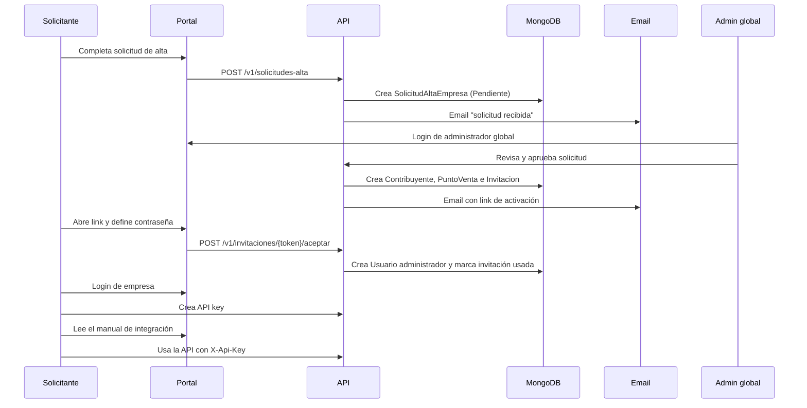

# Proceso de alta de empresa

## Objetivo

Definir el onboarding profesional simulado de FacturAR: una empresa solicita acceso, un administrador global revisa la solicitud, se crea el contribuyente y su punto de venta, y el solicitante activa su cuenta mediante una invitación. Después crea una API key y consulta el manual de integración.

Este proceso reemplaza el registro libre de empresa y usuario administrador. El CUIT es un dato público y no prueba la titularidad de una empresa; por eso el acceso se habilita con una invitación enviada al email del solicitante y aprobada por un administrador de FacturAR.

## Actores

| Actor | Responsabilidad |
| --- | --- |
| Visitante | Consulta la verificación pública y el manual. |
| Solicitante | Envía el formulario público de alta de empresa. |
| Administrador global | Revisa, corrige, aprueba o rechaza solicitudes. |
| Usuario administrador de empresa | Activa su cuenta, administra API keys y usuarios de su empresa. |
| Usuario emisor | Emite comprobantes desde el portal o la API. |
| Usuario consulta | Consulta comprobantes de su empresa. |
| Sistema cliente | Consume la API con una API key de una empresa. |
| AFIP simulado | Genera el CAE simulado; no hay integración real en el MVP. |

## Flujo

### 1. Solicitud pública

El visitante completa:

- Razón social.
- CUIT.
- Condición frente al IVA.
- Nombre y apellido del solicitante.
- Email de contacto.
- Teléfono.
- Domicilio, ciudad, provincia y código postal.
- Mensaje opcional.
- Aceptación de términos y declaración de que la información es correcta.

Validaciones:

- CUIT normalizado y con dígito verificador válido.
- Email con formato válido y normalizado a minúsculas.
- Campos obligatorios completos.
- No debe existir un contribuyente con ese CUIT.
- No debe existir otra solicitud pendiente con el mismo CUIT o el mismo email.
- Rate limit por IP y email para evitar spam.
- La solicitud se crea en estado `Pendiente`; no crea empresa, usuario ni API key.

La respuesta no revela si un CUIT ya existe. Si el CUIT ya está registrado, se muestra un mensaje genérico de revisión y se registra el intento para el administrador.

### 2. Revisión del administrador global

El administrador global ingresa por `/admin/login` con una cuenta separada de los usuarios de empresa. Puede:

- Listar solicitudes por estado, CUIT, razón social o email.
- Ver el detalle completo.
- Corregir razón social, condición IVA, email, teléfono y domicilio antes de aprobar.
- Aprobar la solicitud.
- Rechazar la solicitud con un motivo obligatorio.
- Reenviar la invitación si el email falló, venció o el solicitante la perdió.

Al aprobar, en una sola operación:

1. Se crea el `Contribuyente`.
2. Se crea el `PuntoVenta` número `1` con descripción `Casa Central`.
3. Se crea una `Invitacion` para el email del solicitante, con rol `Administrador`.
4. Se marca la solicitud como `Aprobada`.
5. Se registra el administrador y la fecha de revisión.
6. Se envía el email de invitación.
7. Se registra un evento de auditoría.

Si falla la creación del contribuyente o del punto de venta, no se marca la solicitud como aprobada ni se envía la invitación.

### 3. Invitación y activación

La invitación contiene un token aleatorio de alta entropía. En la base se guarda solo su hash, un prefijo visible y la fecha de expiración. Características:

- Un solo uso.
- Vence a las 48 horas.
- Asociada al email y al contribuyente.
- Se revoca al reenviar una invitación nueva.
- No se registra el token completo en logs.
- El link apunta al portal: `/activar?token=...`.

La página de activación muestra la razón social y el email enmascarado. El solicitante define contraseña y confirmación. Al aceptar:

- Se valida el token, la expiración, el estado y que el contribuyente esté activo.
- Se valida la política de contraseña.
- Se crea el `Usuario` con el `ContribuyenteId` de la invitación, nunca con un id enviado por el navegador.
- Se marca la invitación como usada.
- Se registra auditoría.
- Se redirige al login de empresa.

Si el token es inválido, vencido o ya fue usado, se muestra un mensaje claro y se indica contactar al administrador. El administrador puede reenviar una invitación nueva.

### 4. Login y API key

El usuario de empresa inicia sesión en `/login`. La sesión usa cookie `HttpOnly`, `Secure` en producción y `SameSite=Lax`, con expiración absoluta de 8 horas. Las acciones que modifican datos requieren antiforgery.

Desde el portal, el administrador de empresa:

- Crea una API key con un nombre descriptivo.
- Ve el valor completo una única vez.
- Lista las keys activas y revocadas sin ver el secreto.
- Revoca una key.
- Regenera una key; la anterior deja de funcionar inmediatamente.

La API key se envía en el header `X-Api-Key`. El backend resuelve el `ContribuyenteId` desde la key y nunca desde el body del request.

### 5. Manual de integración

El manual online explica:

- Cómo solicitar acceso y activar la cuenta.
- Cómo crear y revocar una API key.
- Cómo autenticar requests.
- Cómo emitir una factura y consultar comprobantes.
- Cómo usar idempotencia.
- Códigos de error y solución de problemas.
- Buenas prácticas de seguridad.
- Ejemplos en `curl`, JavaScript y C#.

## Estados

### SolicitudAltaEmpresa

| Estado | Significado |
| --- | --- |
| `Pendiente` | Recibida y pendiente de revisión. |
| `Aprobada` | Contribuyente, punto de venta e invitación creados. |
| `Rechazada` | Revisada y rechazada con motivo. |

### Invitacion

| Estado | Significado |
| --- | --- |
| `Pendiente` | Vigente y sin usar. |
| `Usada` | Cuenta creada correctamente. |
| `Vencida` | Superó la fecha de expiración. |
| `Revocada` | Reemplazada por un reenvío o anulada por el administrador. |

## Reglas de seguridad

- El CUIT por sí solo nunca autoriza el acceso a una empresa.
- La aprobación es manual y queda auditada.
- El token de invitación se almacena hasheado, es de un solo uso y vence.
- El email de la invitación debe coincidir con el email del usuario creado.
- El `ContribuyenteId` se toma del contexto autenticado o de la invitación.
- Los administradores globales no son usuarios de empresa y no tienen `ContribuyenteId`.
- Un administrador global `Soporte` puede ver y reenviar invitaciones, pero no aprobar ni rechazar.
- Los usuarios de empresa solo ven datos de su contribuyente.
- Las API keys se almacenan hasheadas y se muestran una única vez.
- Las contraseñas se almacenan con un hash robusto y nunca se devuelven.
- Los endpoints públicos tienen rate limit.
- Las acciones de onboarding generan auditoría.
- Los secretos, tokens y contraseñas no se loguean.

## Emails

| Plantilla | Destinatario | Cuándo |
| --- | --- | --- |
| `SolicitudRecibida` | Solicitante | Al registrar la solicitud. |
| `NuevaSolicitud` | Administración | Al registrar una solicitud, si hay email de administración configurado. |
| `SolicitudAprobada` | Solicitante | Al aprobar y crear la invitación. |
| `SolicitudRechazada` | Solicitante | Al rechazar, con motivo. |
| `InvitacionReenviada` | Solicitante | Al regenerar la invitación. |

En desarrollo se usa un remitente que escribe el email completo en un archivo local; el log solo registra metadatos sin tokens. En producción se configura SMTP por variables de entorno. Un fallo de email no debe perder la solicitud ni la empresa: el administrador puede reenviar la invitación. El cuerpo con token no se persiste en claro.

## Endpoints previstos

| Método | Ruta | Acceso |
| --- | --- | --- |
| `POST` | `/v1/solicitudes-alta` | Público con rate limit. |
| `POST` | `/v1/admin/auth/login` | Público con rate limit. |
| `POST` | `/v1/admin/auth/logout` | Administrador global. |
| `GET` | `/v1/admin/solicitudes` | Administrador global. |
| `GET` | `/v1/admin/solicitudes/{id}` | Administrador global. |
| `PUT` | `/v1/admin/solicitudes/{id}` | Administrador global. |
| `POST` | `/v1/admin/solicitudes/{id}/aprobar` | `SuperAdmin`. |
| `POST` | `/v1/admin/solicitudes/{id}/rechazar` | `SuperAdmin`. |
| `POST` | `/v1/admin/solicitudes/{id}/reenviar-invitacion` | Administrador global. |
| `GET` | `/v1/invitaciones/{token}` | Público con rate limit. |
| `POST` | `/v1/invitaciones/{token}/aceptar` | Público con rate limit. |
| `POST` | `/v1/auth/login` | Público con rate limit. |
| `POST` | `/v1/auth/logout` | Usuario autenticado. |
| `GET` | `/v1/auth/me` | Usuario autenticado. |
| `POST` | `/v1/api-keys` | Administrador de empresa. |
| `GET` | `/v1/api-keys` | Administrador de empresa. |
| `DELETE` | `/v1/api-keys/{id}` | Administrador de empresa. |
| `POST` | `/v1/api-keys/{id}/regenerar` | Administrador de empresa. |

Estos endpoints se implementan en US-01, US-02, US-03, US-04, US-27, US-28 y US-29. Hasta entonces el manual y las historias son la referencia de contrato.

## Relación con AFIP real

En AFIP/ARCA, una empresa debe existir en el padrón, estar habilitada y autenticarse con certificado digital y WSAA para usar WSFEv1. FacturAR no hace esa validación: simula la empresa con un `Contribuyente` en MongoDB y reemplaza la identidad fiscal por la aprobación del administrador global más la invitación al email del solicitante.

En un sistema real, este onboarding debería sumar:

- Validación de identidad del representante legal.
- Verificación de CUIT y constancia de inscripción.
- Certificado digital y delegación de servicios web.
- Contrato y aceptación legal.
- Doble factor para administradores.

Nada de eso forma parte del MVP simulado.

## Decisiones

- No se permite registro libre de empresas.
- No se valida titularidad por CUIT.
- El administrador global se autentica por separado del usuario de empresa.
- La invitación es la prueba de control del email y el mecanismo de activación.
- El punto de venta inicial es `1 Casa Central`.
- La API key se crea después del login, no durante la aprobación.
- El manual es público para facilitar la integración.

## Criterios de demo

1. Enviar una solicitud desde el portal.
2. Ver el email de confirmación en el buzón de desarrollo.
3. Entrar como administrador global y aprobar la solicitud.
4. Abrir el link de invitación y crear la contraseña.
5. Iniciar sesión como usuario de empresa.
6. Crear una API key y copiarla.
7. Usar la API key en un request de emisión.
8. Verificar el comprobante por CAE.
9. Consultar el manual de integración.
